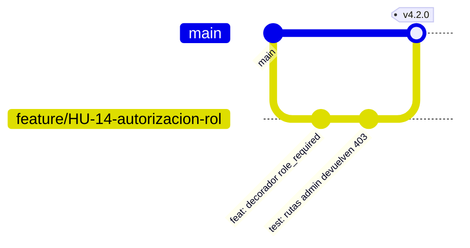

# Guía de contribución

¡Gracias por contribuir a Lion Solver! Esta guía resume el flujo de trabajo del equipo.
El marco de gestión completo está en [docs/03-scrum.md](docs/03-scrum.md).

## Flujo de trabajo



1. Toma una historia del *Sprint Backlog* (debe cumplir la Definition of Ready).
2. Crea una rama desde `main`:

   | Tipo | Formato | Ejemplo |
   |---|---|---|
   | Historia | `feature/HU-xx-descripcion` | `feature/HU-14-autorizacion-rol` |
   | Defecto | `fix/descripcion` | `fix/upload-pdf-template` |
   | Deuda técnica | `refactor/DT-xx-descripcion` | `refactor/DT-04-blueprints` |
   | Documentación | `docs/descripcion` | `docs/manual-coordinador` |

3. Haz commits pequeños con [Conventional Commits](https://www.conventionalcommits.org/es/v1.0.0/):

   ```text
   feat(chatbot): incluir horario de la oficina en el prompt
   fix(admin): precargar valores en el formulario de edición
   docs(uml): actualizar diagrama de secuencia del login
   ```

4. Abre un *pull request* hacia `main` con:
   - referencia a la historia (`HU-xx`) o hallazgo (`SEC-xx`, `DT-xx`);
   - descripción del cambio y cómo probarlo;
   - capturas si cambia la interfaz.
5. Al menos una revisión aprobada y la **Definition of Done** cumplida antes de fusionar.

## Estándares de código

| Ámbito | Norma |
|---|---|
| Python | PEP 8; nombres de funciones en `snake_case`; consultas SQL siempre parametrizadas |
| Rutas nuevas | `@login_required` y verificación de rol cuando corresponda |
| Plantillas | Heredan de `layout.html`; todo formulario `POST` incluye `{{ csrf_token() }}` |
| JavaScript | Sin `innerHTML` con datos de usuario; usar `textContent` |
| Datos a JS | Usar el filtro `tojson` en lugar de `\| safe` |
| Secretos | Nunca en el código; usar `.env` / `config.py` |

## Pruebas

```bash
PYTHONPATH=src pytest -q
```

Toda lógica nueva debe acompañarse de pruebas (ver [docs/11-plan-de-pruebas.md](docs/11-plan-de-pruebas.md)).

## Documentación

Si tu cambio afecta comportamiento, rutas, base de datos o arquitectura, actualiza el
documento correspondiente en `docs/` y agrega una entrada en [CHANGELOG.md](CHANGELOG.md)
bajo **[Sin publicar]**.
