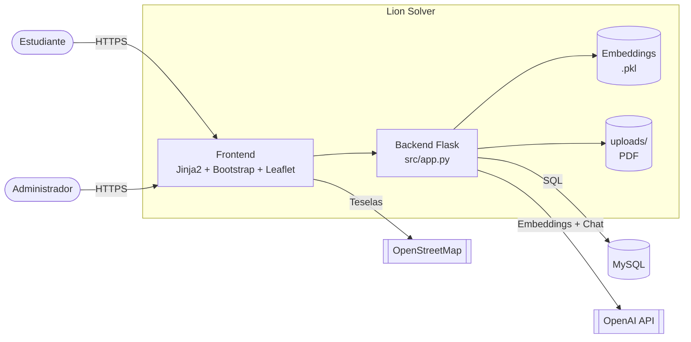

<div align="center">


# Lion Solver

**Sistema de geolocalización de oficinas universitarias con asistente conversacional (chatbot RAG)**


</div>

---

## ¿Qué es Lion Solver?

Lion Solver es una aplicación web que ayuda a los estudiantes de un centro universitario
(caso piloto: **CUCEI**) a **encontrar la oficina correcta para resolver un trámite** y a
**llegar físicamente a ella**.

El estudiante escribe su duda en lenguaje natural (por ejemplo, *"¿dónde entrego mis
papeles del servicio social?"*); el chatbot responde usando la información oficial que
cada oficina ha cargado en PDF y **resalta en el mapa del campus** la oficina que
corresponde.

| Para el estudiante | Para el coordinador de oficina | Para el super administrador |
|---|---|---|
| Mapa interactivo del campus con todas las oficinas | Editar nombre, descripción, teléfono y horario de su oficina | Alta, edición y baja de **campus** (con polígono GeoJSON) |
| Chatbot que responde dudas de trámites | **Entrenar el chatbot** subiendo el PDF de su oficina | Alta, edición y baja de **oficinas** (con coordenadas) |
| Resaltado automático de la oficina en el mapa | Ver el mapa de su campus | Alta, edición y baja de **administradores** |

## Arquitectura en un vistazo



## Inicio rápido

```bash
git clone https://github.com/KevinPonce90/LionSolver.git
cd LionSolver
python -m venv .venv && source .venv/bin/activate     # Windows: .venv\Scripts\activate
pip install -r requirements.txt
cp .env.example .env                                  # agrega tu OPENAI_API_KEY
cp src/config.example.py src/config.py                # credenciales MySQL y SECRET_KEY
mysql -u root -p < docs/database/schema.sql           # crea la base de datos
python src/app.py                                     # http://127.0.0.1:5000
```

> Ejecuta siempre desde la **raíz del repositorio**: las carpetas `embeddings/` y
> `uploads/` se resuelven de forma relativa al directorio de trabajo.
> Guía completa en [docs/09-instalacion-y-despliegue.md](docs/09-instalacion-y-despliegue.md).

## Documentación

Toda la documentación técnica y de gestión vive en [`docs/`](docs/README.md):

| # | Documento | Contenido |
|---|---|---|
| 01 | [Visión del producto](docs/01-vision-del-producto.md) | Problema, objetivos, alcance, stakeholders, glosario |
| 02 | [Especificación de requerimientos](docs/02-requerimientos.md) | Requerimientos funcionales, no funcionales y reglas de negocio |
| 03 | [Gestión ágil (Scrum)](docs/03-scrum.md) | Roles, ceremonias, DoR/DoD, Product Backlog, sprints, roadmap |
| 04 | [Arquitectura](docs/04-arquitectura.md) | Modelo C4, capas, decisiones de arquitectura (ADR) |
| 05 | [Diagramas UML](docs/05-diagramas-uml.md) | Casos de uso, clases, secuencia, actividad, estados, componentes, despliegue |
| 06 | [Base de datos](docs/06-base-de-datos.md) | Diagrama entidad-relación y diccionario de datos |
| 07 | [Referencia de rutas HTTP](docs/07-referencia-rutas.md) | Endpoints, parámetros, respuestas y permisos |
| 08 | [Chatbot RAG](docs/08-chatbot-rag.md) | Ingesta de PDF, embeddings, recuperación y generación |
| 09 | [Instalación y despliegue](docs/09-instalacion-y-despliegue.md) | Requisitos, configuración, ejecución, producción |
| 10 | [Manual de usuario](docs/10-manual-de-usuario.md) | Guía por rol: estudiante, coordinador, super admin |
| 11 | [Plan de pruebas](docs/11-plan-de-pruebas.md) | Estrategia, casos de prueba y criterios de aceptación |
| 12 | [Seguridad, riesgos y deuda técnica](docs/12-seguridad-riesgos-y-deuda-tecnica.md) | Hallazgos, matriz de riesgos y plan de remediación |

Además: [CHANGELOG](CHANGELOG.md) · [Guía de contribución](CONTRIBUTING.md)

## Estructura del repositorio

```text
LionSolver/
├── src/
│   ├── app.py                 # Aplicación Flask (rutas, chatbot RAG, CRUD)
│   ├── app2.py                # Versión anterior sin chatbot (legado)
│   ├── config.py              # Configuración local (NO versionado)
│   ├── models/
│   │   ├── ModelUser.py       # Acceso a datos de estudiantes
│   │   ├── ModelAdmin.py      # Acceso a datos de administradores
│   │   └── entities/          # Entidades User y Admin (Flask-Login)
│   ├── template/              # Vistas Jinja2
│   └── static/                # CSS, JS (mapa, chatbot), imágenes, GeoJSON
├── embeddings/                # Índice vectorial por oficina (embeddings_<office_id>.pkl)
├── uploads/                   # PDFs cargados por las oficinas
├── docs/                      # Documentación del proyecto
└── requirements.txt           # Dependencias (UTF-16)
```

## Stack tecnológico

| Capa | Tecnología |
|---|---|
| Backend | Python 3.12, Flask 3.0, Flask-Login, Flask-WTF (CSRF), Flask-MySQLdb |
| Base de datos | MySQL / MariaDB |
| IA | OpenAI `text-embedding-ada-002` (embeddings) y `gpt-3.5-turbo` (respuesta), `tiktoken`, `scikit-learn` (similitud coseno) |
| Procesamiento de documentos | PyPDF2 |
| Frontend | Jinja2, Bootstrap 5.3, Leaflet, OpenStreetMap, JavaScript vanilla |

## Autor

**Kevin Ponce** — [@KevinPonce90](https://github.com/KevinPonce90)
