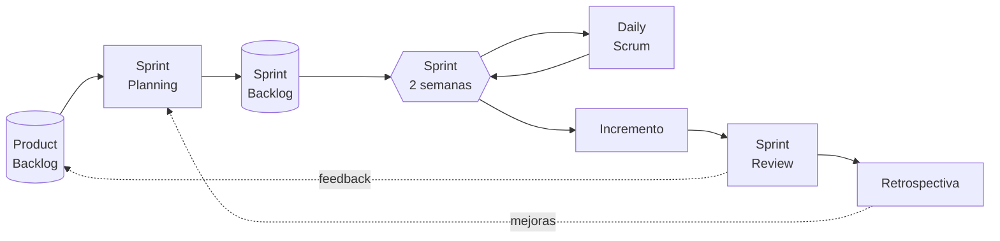
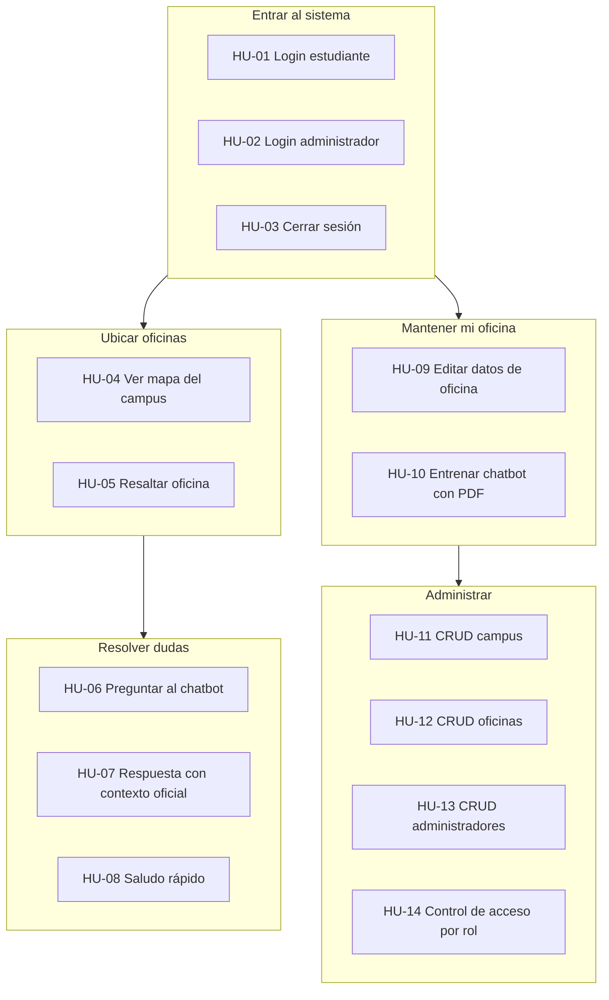
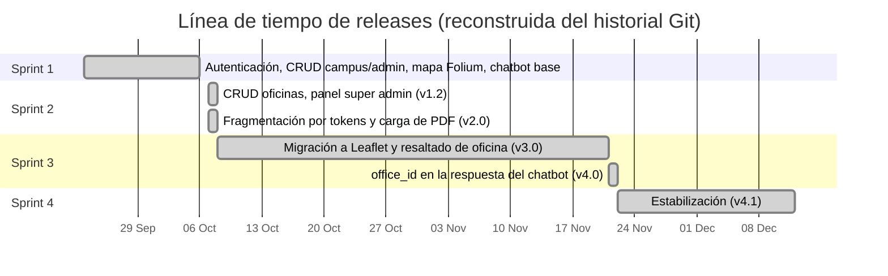
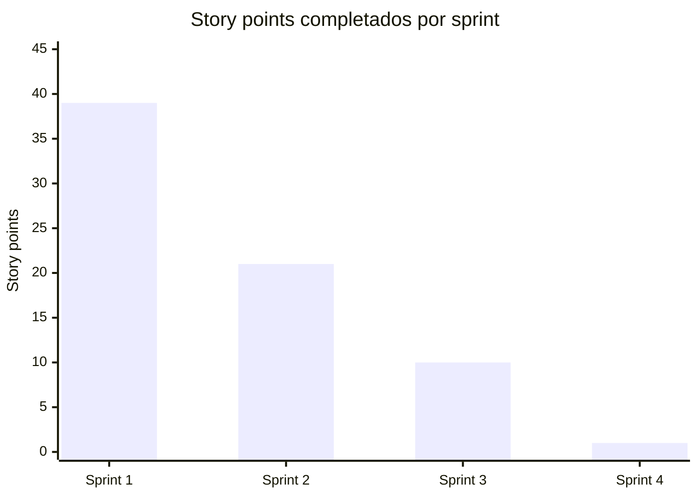
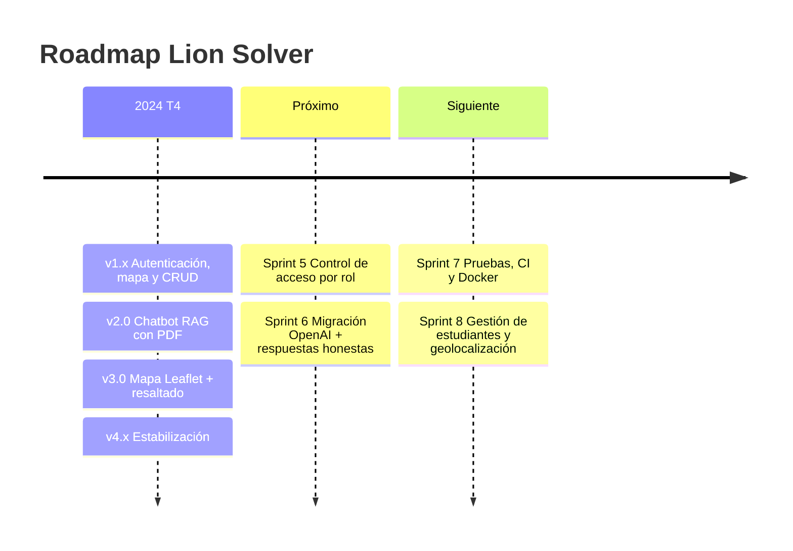

# 03 · Gestión ágil con Scrum

> **Nota metodológica.** El historial del repositorio muestra entregas incrementales
> (versiones 1.0 → 4.1, entre octubre y diciembre de 2024). Los sprints de esta sección
> se **reconstruyeron a partir de esas entregas** para dejar un marco Scrum formal sobre
> el que continuar el proyecto. Las estimaciones en *story points* son de referencia
> (escala Fibonacci) y deben recalibrarse en el siguiente *Sprint Planning*.

## 1. Equipo Scrum

| Rol | Responsable | Responsabilidades |
|---|---|---|
| Product Owner | Por asignar (representante del centro universitario) | Maximizar el valor del producto, ordenar el Product Backlog, aceptar incrementos |
| Scrum Master | Por asignar | Facilitar eventos, eliminar impedimentos, proteger al equipo |
| Developers | Kevin Ponce ([@KevinPonce90](https://github.com/KevinPonce90)) | Construir el incremento: backend, frontend, IA, base de datos |

Stakeholders: estudiantes, coordinadores de oficina, dirección del centro.

## 2. Eventos

| Evento | Duración (sprint de 2 semanas) | Entradas | Salidas |
|---|---|---|---|
| Sprint Planning | 2 h | Product Backlog ordenado, capacidad, Definition of Done | Sprint Goal, Sprint Backlog |
| Daily Scrum | 15 min | Avance del día anterior | Plan para las próximas 24 h, impedimentos |
| Sprint Review | 1 h | Incremento terminado | Feedback, backlog actualizado |
| Sprint Retrospective | 45 min | Datos del sprint | Acciones de mejora (máx. 3) |
| Backlog Refinement | ≤ 10 % de la capacidad | Historias candidatas | Historias que cumplen la DoR |



## 3. Artefactos y compromisos

| Artefacto | Compromiso | Dónde vive |
|---|---|---|
| Product Backlog | Objetivo del producto: *"Que cualquier estudiante encuentre la oficina correcta y llegue a ella en menos de 2 minutos."* | Sección 6 de este documento / GitHub Issues |
| Sprint Backlog | Sprint Goal | GitHub Projects (tablero) |
| Incremento | Definition of Done | Rama `main` + etiqueta de versión |

### 3.1 Definition of Ready (DoR)

Una historia entra a un sprint cuando:

- [ ] Sigue el formato *Como… quiero… para…* y aporta valor identificable.
- [ ] Tiene criterios de aceptación verificables (Gherkin o lista).
- [ ] Está estimada por el equipo.
- [ ] Sus dependencias (datos, diseños, credenciales) están resueltas.
- [ ] Cumple INVEST (Independiente, Negociable, Valiosa, Estimable, Pequeña, *Testable*).

### 3.2 Definition of Done (DoD)

Un incremento está terminado cuando:

- [ ] El código está en `main` mediante *pull request* revisado.
- [ ] Cumple todos los criterios de aceptación.
- [ ] Tiene pruebas automatizadas para la lógica nueva (cuando aplique) y pasa la suite completa.
- [ ] Las rutas nuevas tienen `@login_required` y verificación de rol cuando corresponda.
- [ ] No introduce secretos en el repositorio.
- [ ] La documentación (`docs/`) y el `CHANGELOG.md` están actualizados.
- [ ] Fue demostrado en la Sprint Review y aceptado por el Product Owner.

## 4. Épicas

| ID | Épica | Objetivo | Versión |
|---|---|---|---|
| EP-01 | Autenticación y control de acceso | Que cada persona entre con su código y vea solo lo que le corresponde | 1.1 |
| EP-02 | Mapa interactivo del campus | Ubicar visualmente todas las oficinas | 1.1 → 3.0 |
| EP-03 | Chatbot RAG | Responder dudas con información oficial | 1.1 → 4.0 |
| EP-04 | Autogestión de oficinas | Que cada coordinador mantenga su información | 1.1 → 1.2 |
| EP-05 | Administración del sistema | Gestionar campus, oficinas y cuentas | 1.1 → 1.2 |
| EP-06 | Calidad, seguridad y operación | Hacer el sistema confiable y desplegable | Backlog |

## 5. Mapa de historias (User Story Map)



## 6. Product Backlog

### 6.1 Historias entregadas

| ID | Épica | Historia de usuario | SP | Prioridad | Sprint | Estado |
|---|---|---|---|---|---|---|
| HU-01 | EP-01 | **Como** estudiante **quiero** iniciar sesión con mi código y contraseña **para** acceder al mapa de mi campus. | 3 | Must | 1 | Hecho |
| HU-02 | EP-01 | **Como** administrador **quiero** iniciar sesión con mi código **para** acceder a mi panel. | 2 | Must | 1 | Hecho |
| HU-03 | EP-01 | **Como** usuario **quiero** cerrar sesión **para** proteger mi cuenta en equipos compartidos. | 1 | Must | 1 | Hecho |
| HU-04 | EP-02 | **Como** estudiante **quiero** ver el mapa de mi campus con todas las oficinas **para** saber dónde está cada una. | 5 | Must | 1 → 3 | Hecho |
| HU-05 | EP-02 | **Como** estudiante **quiero** que el mapa resalte la oficina que me sugiere el chatbot **para** no tener que buscarla. | 5 | Should | 3 | Hecho |
| HU-06 | EP-03 | **Como** estudiante **quiero** escribir mi duda en una ventana de chat **para** no tener que navegar por varias páginas. | 3 | Must | 1 | Hecho |
| HU-07 | EP-03 | **Como** estudiante **quiero** recibir respuestas basadas en la información oficial de las oficinas **para** confiar en ellas. | 8 | Must | 1 → 2 | Hecho |
| HU-08 | EP-03 | **Como** estudiante **quiero** que el bot responda a un saludo **para** que la conversación sea natural. | 1 | Could | 1 | Hecho |
| HU-09 | EP-04 | **Como** coordinador **quiero** editar nombre, descripción, teléfono y horario de mi oficina **para** mantenerla actualizada. | 3 | Must | 1 | Hecho |
| HU-10 | EP-04 | **Como** coordinador **quiero** subir el PDF de mi oficina **para** que el chatbot conteste las preguntas frecuentes. | 8 | Must | 1 → 2 | Hecho |
| HU-11 | EP-05 | **Como** super admin **quiero** gestionar campus con su polígono GeoJSON **para** dar soporte a varios centros. | 5 | Must | 1 | Hecho |
| HU-12 | EP-05 | **Como** super admin **quiero** gestionar oficinas con sus coordenadas **para** que aparezcan en el mapa. | 5 | Must | 2 | Hecho |
| HU-13 | EP-05 | **Como** super admin **quiero** gestionar cuentas de administradores **para** asignar coordinadores a oficinas. | 5 | Must | 1 | Hecho |

### 6.2 Backlog pendiente (ordenado por prioridad)

| ID | Épica | Historia de usuario | SP | Prioridad | Origen |
|---|---|---|---|---|---|
| HU-14 | EP-01 | **Como** super admin **quiero** que solo mi rol pueda ejecutar operaciones de administración **para** evitar cambios no autorizados. | 5 | Must | SEC-01 |
| HU-15 | EP-04 | **Como** coordinador **quiero** que el formulario de edición muestre los datos actuales de mi oficina **para** no borrarlos por accidente. | 2 | Must | DT-06 |
| HU-16 | EP-03 | **Como** estudiante **quiero** que la respuesta incluya el teléfono y horario reales de la oficina **para** contactarla. | 3 | Should | RF-13 |
| HU-17 | EP-06 | **Como** equipo **queremos** migrar al SDK actual de OpenAI y a modelos vigentes **para** evitar la obsolescencia de la API. | 5 | Should | DT-01 |
| HU-18 | EP-06 | **Como** equipo **queremos** pruebas automatizadas y CI **para** detectar regresiones. | 8 | Should | DT-08 |
| HU-19 | EP-03 | **Como** estudiante **quiero** ver un indicador de "escribiendo…" **para** saber que el bot está procesando. | 1 | Could | UX |
| HU-20 | EP-05 | **Como** super admin **quiero** gestionar cuentas de estudiantes **para** no depender de la base de datos directa. | 8 | Could | RF-27 |
| HU-21 | EP-06 | **Como** operador **quiero** desplegar con Docker y Gunicorn **para** tener un entorno de producción reproducible. | 5 | Should | DT-10 |
| HU-22 | EP-02 | **Como** estudiante **quiero** ver mi ubicación actual en el mapa **para** orientarme hacia la oficina. | 3 | Could | Feedback |
| HU-23 | EP-03 | **Como** estudiante **quiero** que el bot responda "no lo sé" cuando la información no exista **para** no recibir datos inventados. | 3 | Should | Calidad IA |

### 6.3 Criterios de aceptación (selección, formato Gherkin)

**HU-01 · Login de estudiante**

```gherkin
Escenario: Estudiante activo con credenciales correctas
  Dado que existe el estudiante con código "219000001" activo
  Cuando ingresa su código y su contraseña correcta
  Entonces es redirigido a "/home"
  Y ve el mapa de su campus

Escenario: Estudiante inactivo
  Dado que el estudiante "219000002" tiene user_active = 0
  Cuando ingresa credenciales correctas
  Entonces permanece en "/login"
  Y ve el mensaje "Contraseña incorrecta o Estudiante no activo"

Escenario: Código inexistente
  Cuando ingresa un código que no existe
  Entonces ve el mensaje "Usurario no encontrado"
```

**HU-05 · Resaltar oficina**

```gherkin
Escenario: El chatbot identifica una oficina
  Dado que estoy en "/home" con el mapa cargado
  Cuando el chatbot responde con office_id = 6
  Entonces el marcador de la oficina 6 cambia al icono resaltado
  Y el mapa se centra en ella con zoom 18
  Y se abre su ventana emergente
```

**HU-10 · Entrenar chatbot con PDF**

```gherkin
Escenario: PDF con texto
  Dado que soy coordinador de la oficina 6
  Cuando subo "lineamientos.pdf" con texto extraíble
  Entonces se crea o reemplaza "embeddings/embeddings_6.pkl"
  Y el índice en memoria se recarga sin reiniciar el servidor
  Y veo "El PDF ha sido procesado y los embeddings se han generado correctamente."

Escenario: PDF sin texto (escaneado)
  Cuando subo un PDF del que no se puede extraer texto
  Entonces no se generan embeddings
  Y se me informa que el PDF no contiene texto
```

**HU-14 · Control de acceso por rol**

```gherkin
Escenario: Estudiante intenta crear un administrador
  Dado que tengo sesión como estudiante
  Cuando envío POST a "/admin_Add"
  Entonces recibo HTTP 403
  Y no se crea ningún registro
```

## 7. Sprints (reconstrucción histórica)

| Sprint | Periodo | Sprint Goal | Historias | SP | Release |
|---|---|---|---|---|---|
| Sprint 0 | hasta 2024-10-06 | Preparar repositorio y visión | Setup, README | — | v1.0 |
| Sprint 1 | → 2024-10-06 | *"Un usuario puede entrar, ver el mapa de su campus y hacer una pregunta al chatbot."* | HU-01, 02, 03, 04, 06, 07 (base), 08, 09, 10 (base), 11, 13 | 39 | v1.1 |
| Sprint 2 | 2024-10-07 | *"El super admin gestiona oficinas y el chatbot procesa PDFs largos de forma robusta."* | HU-12, HU-07 (fragmentación por tokens), HU-10 (carga a `uploads/`) | 21 | v1.2, v2.0 |
| Sprint 3 | 2024-10-08 → 2024-11-21 | *"El chatbot señala en el mapa la oficina de la respuesta."* | HU-04 (migración Folium → Leaflet), HU-05 | 10 | v3.0, v4.0 |
| Sprint 4 | 2024-11-22 → 2024-12-12 | *"Estabilizar la versión candidata."* | Limpieza de `chatbot.js` | 1 | v4.1 |



### 7.1 Velocidad



Velocidad media de referencia: **~18 SP/sprint**. El Sprint 1 concentra la mayor parte
del alcance porque el primer commit funcional (v1.1) incluyó casi toda la aplicación;
en adelante se recomienda planificar con una capacidad de **15–20 SP** por sprint de
dos semanas.

### 7.2 Retrospectivas (síntesis)

| Sprint | ¿Qué salió bien? | ¿Qué mejorar? | Acción |
|---|---|---|---|
| 1 | Se entregó un producto usable de extremo a extremo. | Commit único muy grande; sin pruebas. | Commits pequeños por historia; PR por historia. |
| 2 | La fragmentación por tokens resolvió PDFs largos. | `app2.py` duplicado queda como código muerto. | Eliminar código legado o moverlo a una rama. |
| 3 | Leaflet permitió interacción entre chatbot y mapa. | La métrica "oficina más común" se cambió por "top‑1" sin medir precisión. | Crear un conjunto de preguntas de evaluación. |
| 4 | Versión estable para demo. | No hay control de acceso por rol en rutas admin. | Priorizar HU-14 al inicio del siguiente sprint. |

## 8. Roadmap propuesto

| Sprint | Sprint Goal propuesto | Historias | SP |
|---|---|---|---|
| Sprint 5 | *"Solo quien debe puede administrar."* | HU-14, HU-15, HU-16 | 10 |
| Sprint 6 | *"El chatbot es mantenible y honesto."* | HU-17, HU-23, HU-19 | 9 |
| Sprint 7 | *"Cada cambio se prueba y se despliega igual."* | HU-18, HU-21 | 13 |
| Sprint 8 | *"Más autonomía para administradores y estudiantes."* | HU-20, HU-22 | 11 |



## 9. Tablero Kanban sugerido (GitHub Projects)

| Columna | Política (WIP) |
|---|---|
| Backlog | Historias refinadas que cumplen DoR |
| Sprint Backlog | Comprometidas en el Sprint Planning |
| En progreso | WIP ≤ 2 por developer |
| En revisión | PR abierto, esperando revisión |
| Hecho | Cumple la DoD |

Etiquetas recomendadas: `épica:EP-0x`, `tipo:historia`, `tipo:bug`, `tipo:deuda-técnica`,
`prioridad:must|should|could`, `sp:1|2|3|5|8|13`.
