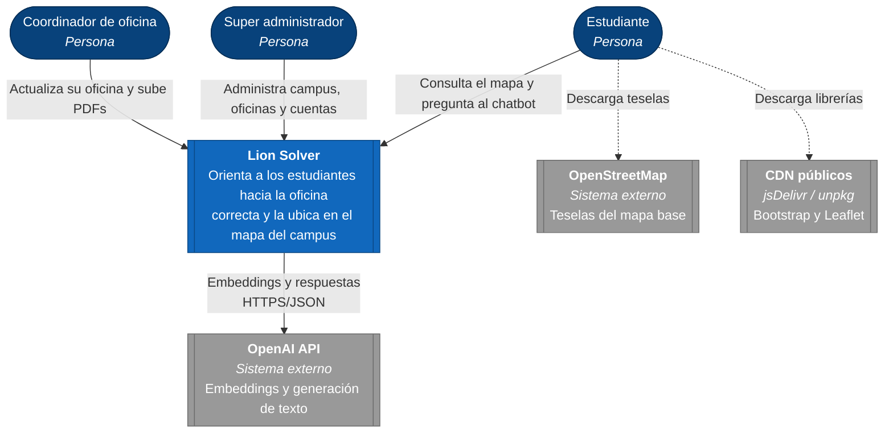
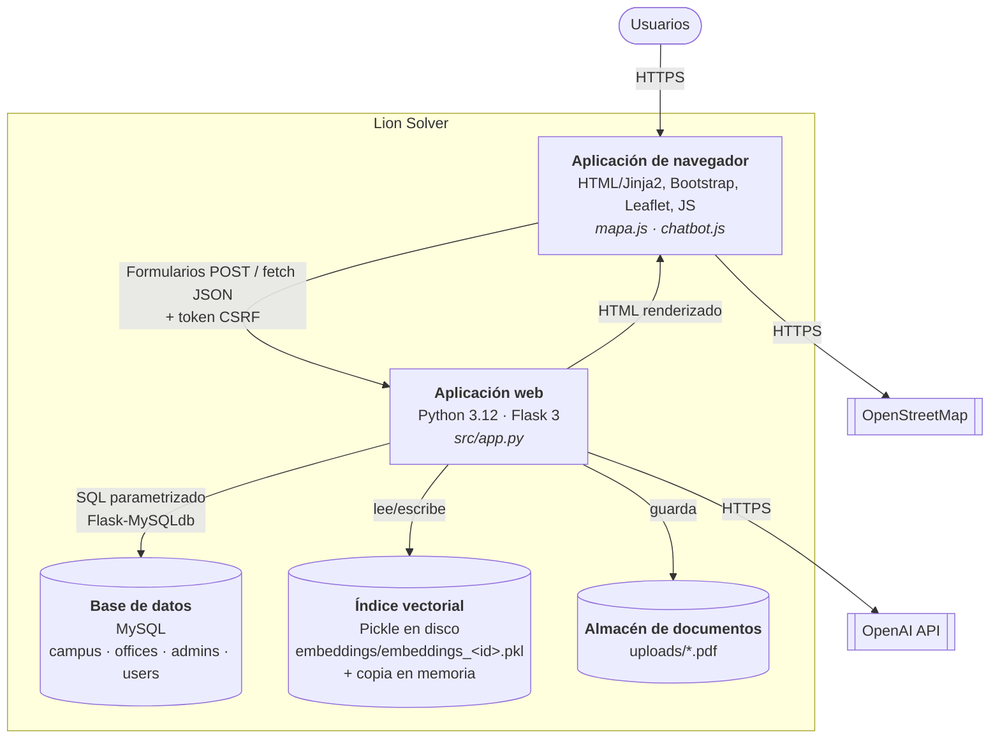
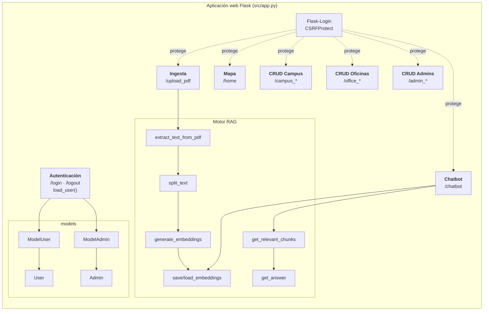
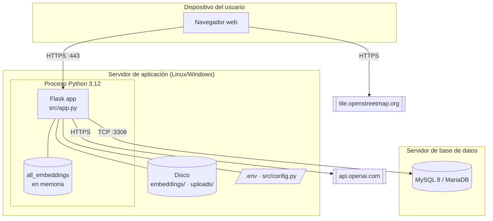

# 04 · Arquitectura del sistema

## 1. Estilo arquitectónico

Lion Solver es un **monolito web de renderizado en servidor** (Flask + Jinja2) con un
patrón **MVC simplificado**:

| Capa MVC | Implementación |
|---|---|
| **Modelo** | `src/models/entities/` (entidades `User`, `Admin`) y `src/models/` (`ModelUser`, `ModelAdmin` — acceso a datos). El resto del SQL vive en las funciones de vista. |
| **Vista** | Plantillas Jinja2 en `src/template/` + JavaScript del cliente (`mapa.js`, `chatbot.js`). |
| **Controlador** | Funciones de ruta en `src/app.py`. |

Sobre ese núcleo se añade un **subsistema RAG** (Retrieval-Augmented Generation) en el
mismo proceso, con un índice vectorial en memoria persistido en archivos `.pkl`.

## 2. Modelo C4

### 2.1 Nivel 1 — Contexto del sistema

### 2.2 Nivel 2 — Contenedores

### 2.3 Nivel 3 — Componentes de la aplicación web

## 3. Vista de despliegue

En desarrollo todo corre en una sola máquina con el servidor integrado de Werkzeug. Para
producción ver [09-instalacion-y-despliegue.md](09-instalacion-y-despliegue.md).

> **Restricción importante:** el índice vectorial `all_embeddings` es una lista global
> del proceso. Con varios *workers* (p. ej. Gunicorn `-w 4`), un PDF subido en un worker
> no se refleja en los demás hasta reiniciarlos. Mientras no se migre a un almacén
> vectorial compartido, desplegar con **un solo worker** (puede usar varios *threads*).

## 4. Flujos principales

| Flujo | Descripción breve | Diagrama |
|---|---|---|
| Inicio de sesión | Se busca el código en `users` y en `admins`; se valida el hash y se crea la sesión. | [Secuencia 1](05-diagramas-uml.md#41-inicio-de-sesión) |
| Consulta al chatbot | Embedding de la pregunta → top‑5 por similitud coseno → prompt con contexto → respuesta + `office_id`. | [Secuencia 2](05-diagramas-uml.md#42-consulta-al-chatbot-y-resaltado-en-el-mapa) |
| Entrenamiento | PDF → texto → fragmentos ≤ 500 tokens → embeddings → `.pkl` → recarga del índice. | [Secuencia 3](05-diagramas-uml.md#43-entrenamiento-del-chatbot-carga-de-pdf) |
| Visualización del mapa | Consulta campus + oficinas → JSON embebido en la plantilla → Leaflet. | [Secuencia 4](05-diagramas-uml.md#44-carga-del-mapa-del-campus) |

## 5. Decisiones de arquitectura (ADR)

### ADR-001 · Flask como framework web
- **Estado:** aceptada (v1.1).
- **Contexto:** equipo pequeño, necesidad de prototipar rápido con Python (mismo lenguaje que el ecosistema de IA).
- **Decisión:** Flask con extensiones (Flask-Login, Flask-WTF, Flask-MySQLdb).
- **Consecuencias:** curva de aprendizaje baja; la estructura queda a criterio del equipo, lo que derivó en un `app.py` monolítico (ver DT-04).

### ADR-002 · MySQL con SQL directo (sin ORM)
- **Estado:** aceptada (v1.1).
- **Decisión:** `flask_mysqldb` con cursores y consultas parametrizadas.
- **Consecuencias:** control total del SQL; no hay migraciones versionadas ni esquema en el repositorio (se agrega [`docs/database/schema.sql`](database/schema.sql)).

### ADR-003 · RAG con OpenAI en lugar de *fine-tuning*
- **Estado:** aceptada (v1.1, refinada en v2.0 y v4.0).
- **Contexto:** la información cambia por oficina y con frecuencia; el personal no técnico debe poder actualizarla.
- **Decisión:** generar embeddings de fragmentos de PDF y recuperar los más similares para dar contexto a un modelo de chat.
- **Consecuencias:** actualizar conocimiento = subir un PDF; costo por consulta bajo; dependencia de un proveedor externo.

### ADR-004 · Índice vectorial en archivos Pickle + memoria
- **Estado:** aceptada (v1.1), **revisar**.
- **Decisión:** un archivo `.pkl` por oficina, cargados a una lista en memoria al iniciar.
- **Consecuencias:** cero infraestructura adicional; búsqueda lineal O(n) suficiente para decenas de oficinas; no apto para múltiples procesos; `pickle` no debe cargar archivos de origen no confiable.
- **Alternativas para el futuro:** pgvector, Chroma, FAISS, SQLite‑vss.

### ADR-005 · Migración de Folium a Leaflet en el cliente
- **Estado:** aceptada (v3.0), sustituye la generación del mapa en servidor con Folium.
- **Contexto:** el mapa generado por Folium se insertaba como `iframe`, lo que impedía que el chatbot interactuara con él.
- **Decisión:** el servidor entrega JSON (oficinas + GeoJSON) y el cliente dibuja con Leaflet.
- **Consecuencias:** se habilita `highlightOffice()`; menor carga en servidor. `folium` sigue en `requirements.txt` sin uso (DT-03).

### ADR-006 · Oficina de la respuesta = fragmento más similar (top‑1)
- **Estado:** aceptada (v4.0), sustituye a "oficina más frecuente en el top‑5".
- **Consecuencias:** respuesta más predecible cuando una oficina domina la pregunta; puede fallar si el mejor fragmento es genérico. Se recomienda medir con un set de evaluación (ver [08-chatbot-rag.md](08-chatbot-rag.md#6-evaluación-recomendada)).

## 6. Atributos de calidad y tácticas

| Atributo | Táctica aplicada | Mejora propuesta |
|---|---|---|
| Seguridad | Hash de contraseñas, CSRF, SQL parametrizado, `@login_required` | Autorización por rol, límites de tamaño/tipo de archivo, `secure_filename` |
| Disponibilidad | Captura de excepciones en llamadas a OpenAI | Reintentos con *backoff*, *timeouts* |
| Desempeño | Índice en memoria; solo 2 llamadas a la API por pregunta | Vectorizar la similitud con NumPy; caché de embeddings de preguntas frecuentes |
| Mantenibilidad | Paquete `models/` | Blueprints por módulo, capa de servicios, pruebas |
| Portabilidad | Configuración por `.env` | Contenedor Docker |
