# 05 · Diagramas UML

Todos los diagramas están en Mermaid y reflejan el código de la versión 4.1.

| # | Diagrama UML | Tipo | Sección |
|---|---|---|---|
| 1 | Casos de uso | Comportamiento | [§1](#1-diagrama-de-casos-de-uso) |
| 2 | Clases | Estructura | [§2](#2-diagrama-de-clases) |
| 3 | Paquetes | Estructura | [§3](#3-diagrama-de-paquetes) |
| 4 | Secuencia (×5) | Interacción | [§4](#4-diagramas-de-secuencia) |
| 5 | Actividad (×3) | Comportamiento | [§5](#5-diagramas-de-actividad) |
| 6 | Máquina de estados (×3) | Comportamiento | [§6](#6-diagramas-de-estados) |
| 7 | Componentes | Estructura | [§7](#7-diagrama-de-componentes) |
| 8 | Despliegue | Estructura | [§8](#8-diagrama-de-despliegue) |

---

## 1. Diagrama de casos de uso

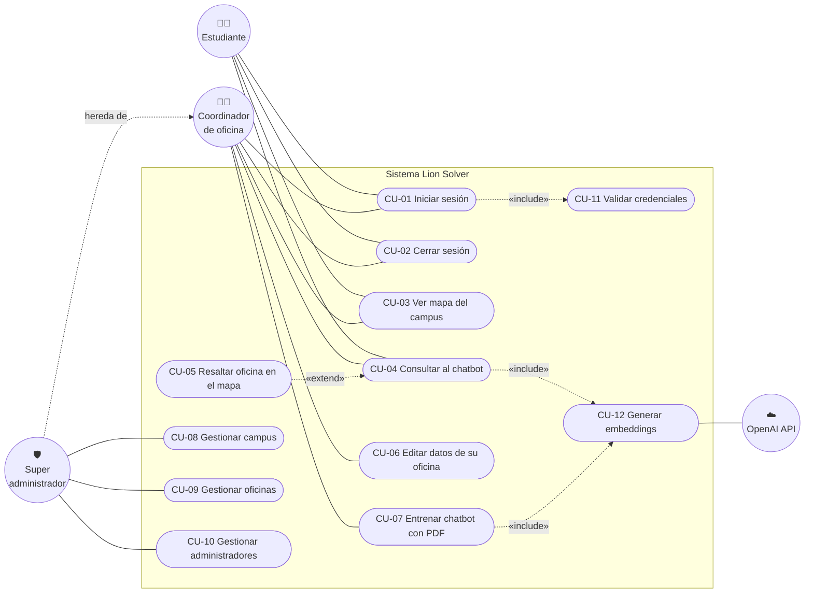

> Mermaid no tiene notación nativa de casos de uso; se representa con nodos ovalados
> (casos de uso), círculos (actores) y relaciones `«include»` / `«extend»` punteadas.

### 1.1 Especificación de casos de uso principales

#### CU-01 · Iniciar sesión

| Campo | Detalle |
|---|---|
| Actor principal | Estudiante, Coordinador, Super administrador |
| Precondición | El usuario existe en `users` o `admins`. |
| Disparador | El usuario abre `/login`. |
| Flujo principal | 1. Ingresa código y contraseña. 2. El sistema busca el código en `users` y en `admins`. 3. Valida el hash de contraseña. 4. Si es estudiante activo → `/home`; si es administrador → `/admin`. |
| Flujos alternos | 3a. Contraseña incorrecta o estudiante inactivo → mensaje y permanece en login. 2a. Código inexistente → "Usurario no encontrado". |
| Postcondición | Sesión de Flask-Login creada con el `id` = código. |

#### CU-04 · Consultar al chatbot

| Campo | Detalle |
|---|---|
| Actor principal | Usuario autenticado |
| Actor secundario | OpenAI API |
| Precondición | Sesión activa; vista `/home` cargada. |
| Flujo principal | 1. Abre la ventana del chatbot. 2. Escribe la pregunta y pulsa *Enviar* o *Enter*. 3. El cliente hace `POST /chatbot` con token CSRF. 4. El sistema obtiene el embedding de la pregunta. 5. Selecciona los 5 fragmentos más similares. 6. Envía el contexto y la pregunta al modelo de chat. 7. Devuelve `{reply, office_id}`. 8. El cliente muestra la respuesta y ejecuta CU-05. |
| Flujos alternos | 4a. No hay embeddings cargados → mensaje "El chatbot aún no está listo…". 6a. Error del modelo → "Lo siento, ha ocurrido un error al obtener la respuesta." 3a. Error HTTP → "Lo siento, ha ocurrido un error." Pregunta = saludo exacto → respuesta fija sin llamar al modelo de chat. |
| Postcondición | Respuesta visible; oficina resaltada si existe en el mapa. |

#### CU-07 · Entrenar chatbot con PDF

| Campo | Detalle |
|---|---|
| Actor principal | Coordinador de oficina |
| Precondición | Sesión de administrador; la cuenta tiene oficina asignada. |
| Flujo principal | 1. Abre "Entrenar Chatbot". 2. Selecciona un PDF. 3. El sistema lo guarda en `uploads/`. 4. Extrae el texto. 5. Lo divide en fragmentos ≤ 500 tokens. 6. Genera un embedding por fragmento. 7. Guarda `embeddings/embeddings_<office_id>.pkl`. 8. Recarga el índice global. 9. Muestra confirmación. |
| Flujos alternos | 4a. Texto vacío → mensaje de error. 6a. Falla un fragmento → se omite y continúa. |
| Postcondición | El chatbot responde con la nueva información de la oficina. |

---

## 2. Diagrama de clases

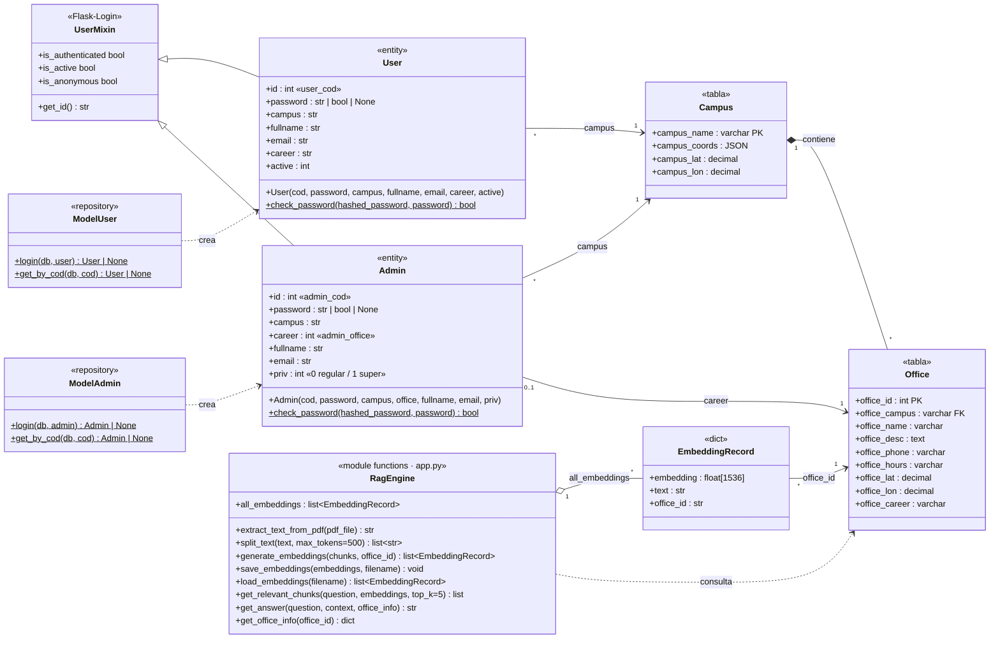

**Notas de diseño**

- `password` en las entidades reutiliza el mismo atributo para tres significados: la
  contraseña en claro (al construir la credencial), el resultado booleano de
  `check_password` (tras el login) y `None` (al recargar desde sesión). Ver DT-05.
- En `Admin`, la oficina se guarda en el atributo `career` para que `upload_pdf` use
  `current_user.career` como `office_id` de los embeddings.
- `RagEngine` no es una clase real: agrupa las funciones de módulo de `src/app.py`
  relacionadas con el chatbot. Se modela así para mostrar sus responsabilidades.

---

## 3. Diagrama de paquetes

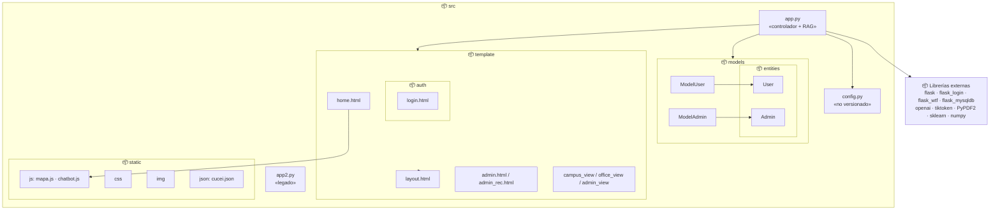

---

## 4. Diagramas de secuencia

### 4.1 Inicio de sesión

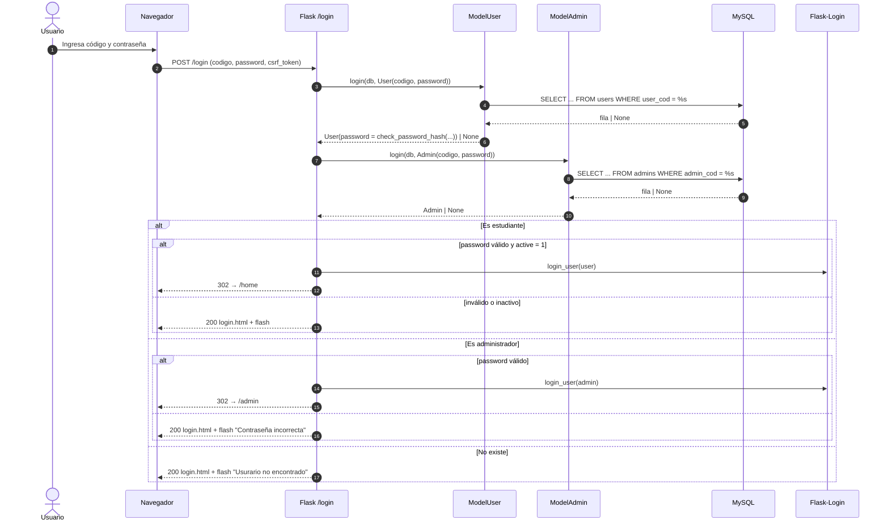

### 4.2 Consulta al chatbot y resaltado en el mapa

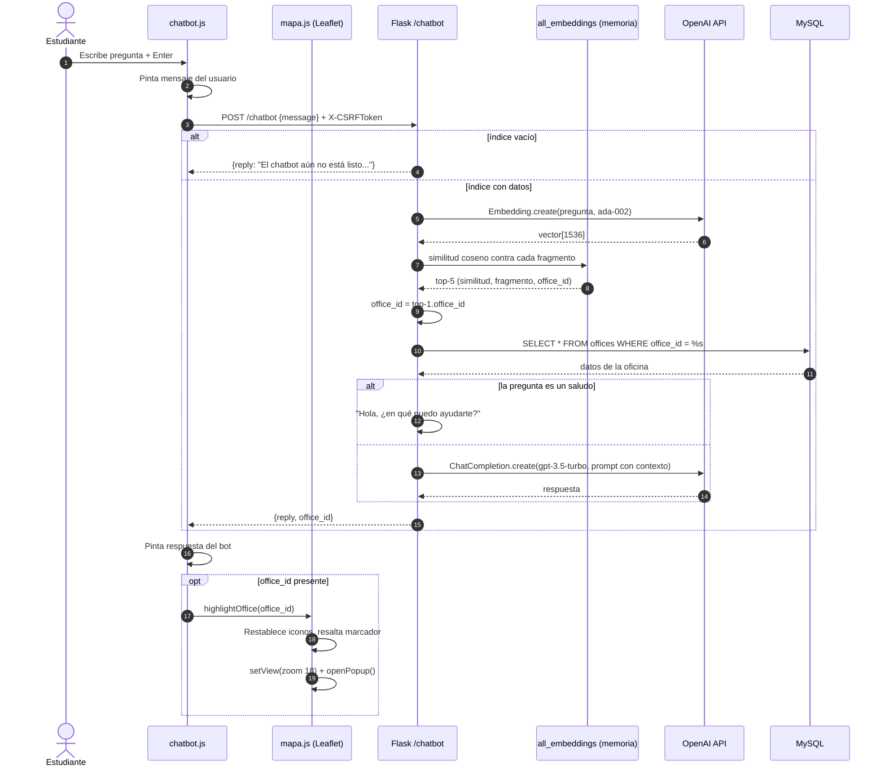

### 4.3 Entrenamiento del chatbot (carga de PDF)

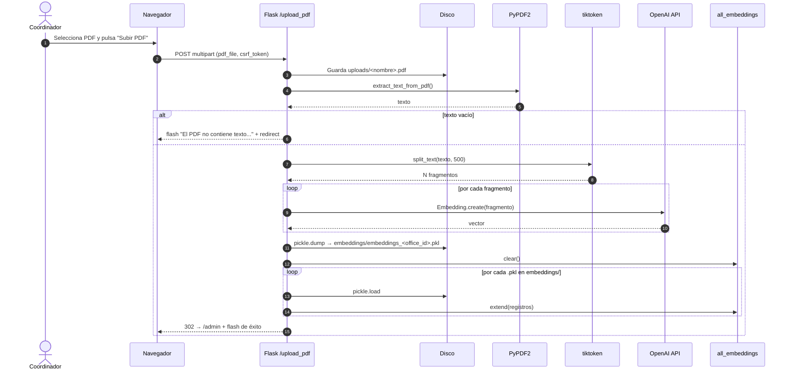

### 4.4 Carga del mapa del campus

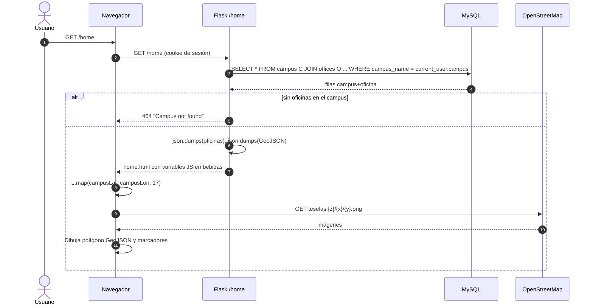

### 4.5 Operación CRUD genérica (ej. alta de oficina)

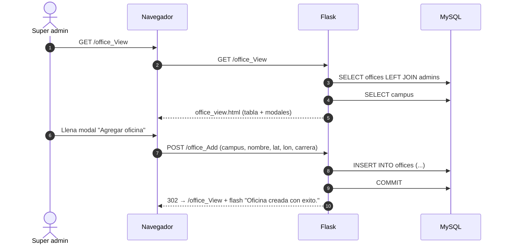

---

## 5. Diagramas de actividad

### 5.1 Autenticación

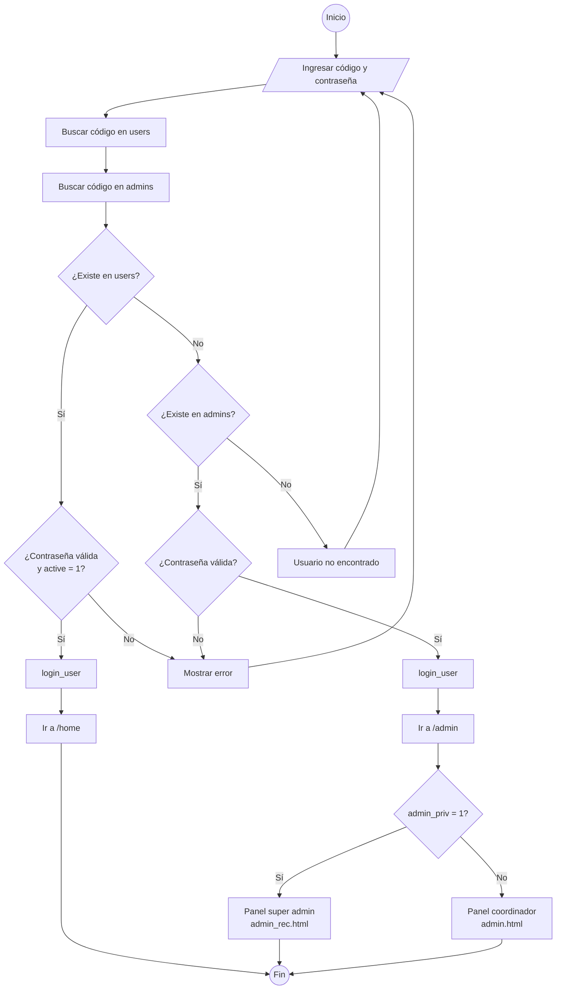

### 5.2 Ingesta de PDF (pipeline RAG offline)

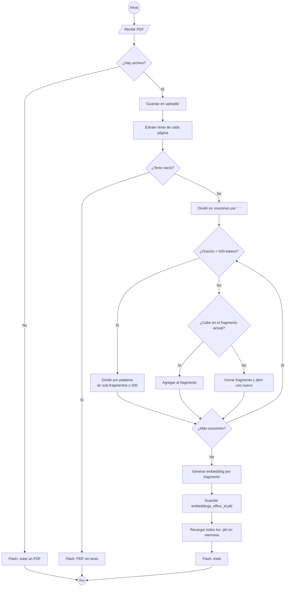

### 5.3 Respuesta del chatbot

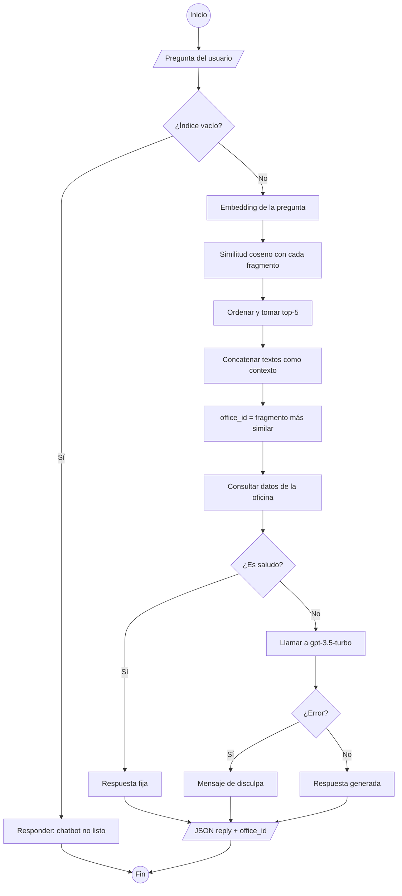

---

## 6. Diagramas de estados

### 6.1 Sesión de usuario

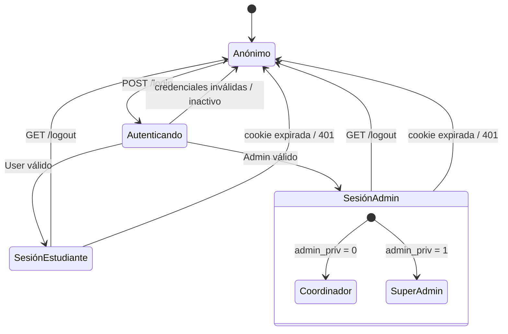

### 6.2 Conocimiento de una oficina en el chatbot

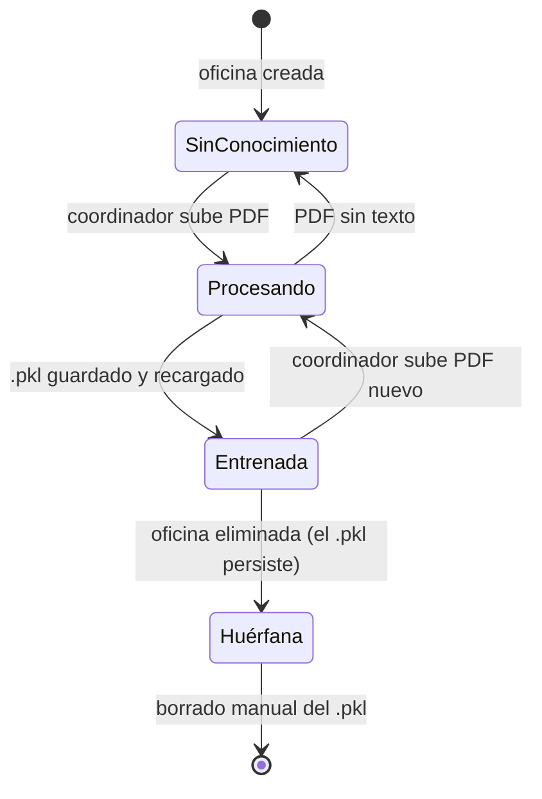

### 6.3 Ventana del chatbot (cliente)

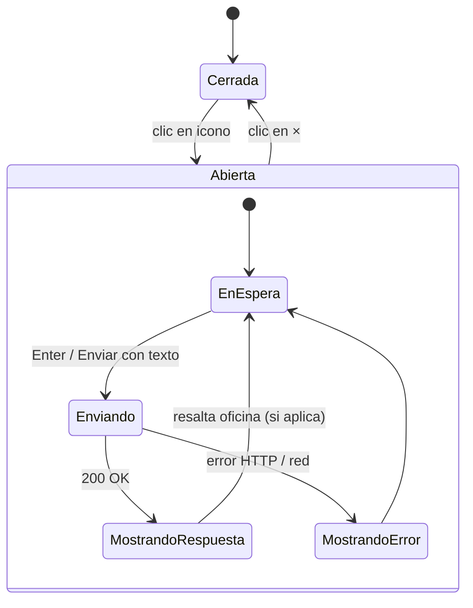

---

## 7. Diagrama de componentes

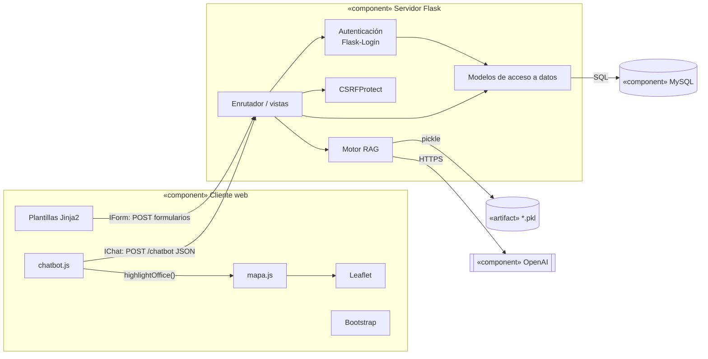

---

## 8. Diagrama de despliegue

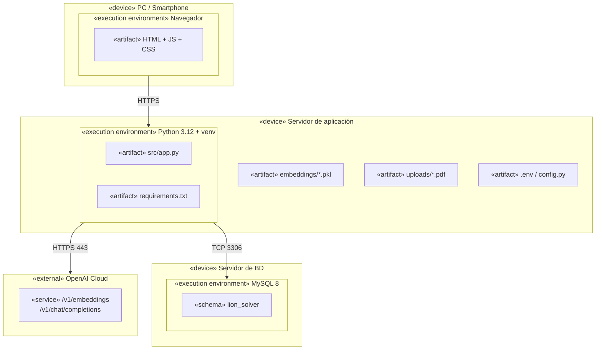
