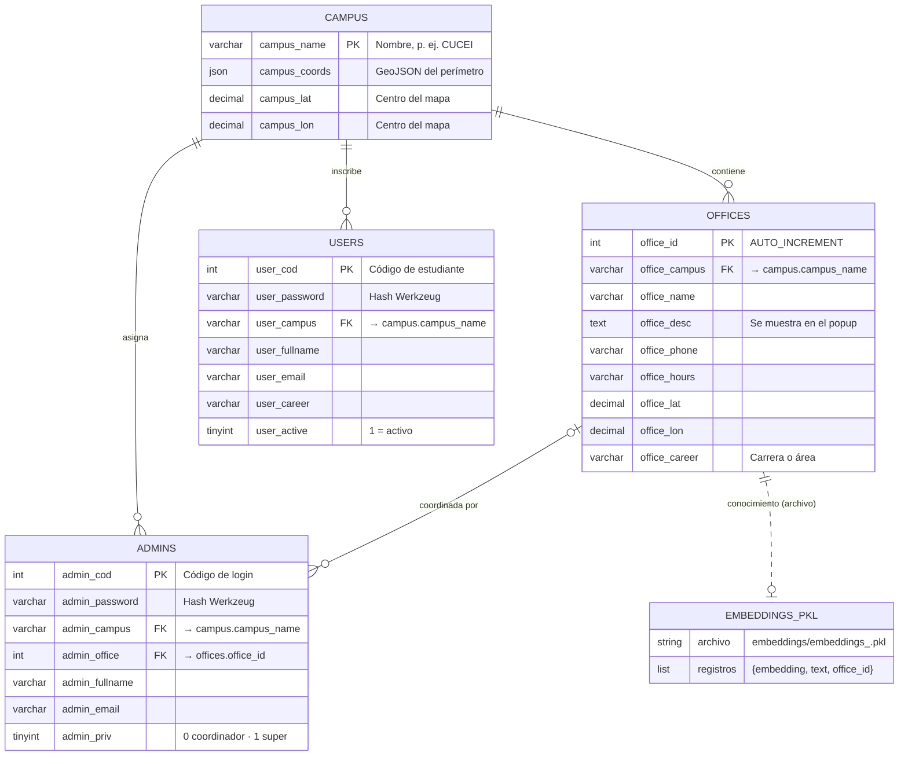

# 06 · Base de datos

Motor: **MySQL 8** (compatible con MariaDB 10.5+). Acceso mediante `flask_mysqldb`
(`mysqlclient`) con consultas parametrizadas.

> El esquema se **reconstruyó** a partir de las consultas del código (no había DDL en el
> repositorio). Script listo para ejecutar: [`database/schema.sql`](database/schema.sql).

## 1. Modelo entidad-relación



`EMBEDDINGS_PKL` no es una tabla: representa los archivos del índice vectorial, ligados
por convención de nombre a `offices.office_id`.

## 2. Modelo relacional

```text
campus  (campus_name PK, campus_coords, campus_lat, campus_lon)
offices (office_id PK, office_campus FK→campus, office_name, office_desc,
         office_phone, office_hours, office_lat, office_lon, office_career)
admins  (admin_cod PK, admin_password, admin_campus FK→campus,
         admin_office FK→offices, admin_fullname, admin_email, admin_priv)
users   (user_cod PK, user_password, user_campus FK→campus,
         user_fullname, user_email, user_career, user_active)
```

Normalización: el esquema está en **3FN**. La clave natural de `campus` (nombre) se
propaga como FK; se recomienda a futuro una clave sustituta `campus_id` para permitir
renombrar campus sin cascadas.

## 3. Diccionario de datos

### 3.1 `campus`

| Columna | Tipo | Nulo | Clave | Descripción | Origen en código |
|---|---|---|---|---|---|
| `campus_name` | VARCHAR(100) | No | PK | Nombre único del campus | `campus_Add`, `home` |
| `campus_coords` | JSON | No | | `FeatureCollection` GeoJSON con el perímetro | Archivo subido en `campus_Add`/`campus_Edit` |
| `campus_lat` | DECIMAL(10,7) | No | | Latitud para centrar el mapa | `mapa.js` → `setView` |
| `campus_lon` | DECIMAL(10,7) | No | | Longitud para centrar el mapa | `mapa.js` → `setView` |

### 3.2 `offices`

| Columna | Tipo | Nulo | Clave | Descripción | Editable por |
|---|---|---|---|---|---|
| `office_id` | INT AI | No | PK | Identificador; también nombra el archivo de embeddings | — |
| `office_campus` | VARCHAR(100) | No | FK | Campus al que pertenece | Super admin |
| `office_name` | VARCHAR(150) | No | | Nombre visible | Super admin, coordinador |
| `office_desc` | TEXT | Sí | | Descripción en el popup del mapa | Coordinador |
| `office_phone` | VARCHAR(50) | Sí | | Teléfono de contacto | Coordinador |
| `office_hours` | VARCHAR(100) | Sí | | Horario de atención | Coordinador |
| `office_lat` | DECIMAL(10,7) | No | | Latitud del marcador | Super admin |
| `office_lon` | DECIMAL(10,7) | No | | Longitud del marcador | Super admin |
| `office_career` | VARCHAR(150) | Sí | | Carrera/área que atiende | Super admin |

### 3.3 `admins`

| Columna | Tipo | Nulo | Clave | Descripción |
|---|---|---|---|---|
| `admin_cod` | INT | No | PK | Código de inicio de sesión |
| `admin_password` | VARCHAR(255) | No | | Hash generado con `generate_password_hash` |
| `admin_campus` | VARCHAR(100) | No | FK | Campus del administrador (define el mapa que ve) |
| `admin_office` | INT | Sí | FK | Oficina que coordina; se usa como `office_id` al subir PDF |
| `admin_fullname` | VARCHAR(150) | No | | Nombre completo |
| `admin_email` | VARCHAR(150) | No | | Correo institucional |
| `admin_priv` | TINYINT(1) | No | | `1` super admin · `0` coordinador |

### 3.4 `users`

| Columna | Tipo | Nulo | Clave | Descripción |
|---|---|---|---|---|
| `user_cod` | INT | No | PK | Código de estudiante |
| `user_password` | VARCHAR(255) | No | | Hash Werkzeug |
| `user_campus` | VARCHAR(100) | No | FK | Campus cuyo mapa verá |
| `user_fullname` | VARCHAR(150) | No | | Nombre completo (se muestra en el encabezado del mapa) |
| `user_email` | VARCHAR(150) | No | | Correo |
| `user_career` | VARCHAR(150) | Sí | | Carrera |
| `user_active` | TINYINT(1) | No | | `1` permite iniciar sesión |

## 4. Consultas principales

| Uso | Consulta | Ubicación |
|---|---|---|
| Login estudiante | `SELECT user_cod, user_password, … FROM users WHERE user_cod = %s` | `src/models/ModelUser.py:8` |
| Login admin | `SELECT admin_cod, admin_password, … FROM admins WHERE admin_cod = %s` | `src/models/ModelAdmin.py:8` |
| Mapa | `SELECT * FROM campus C INNER JOIN offices O ON C.campus_name = O.office_campus WHERE campus_name = %s` | `src/app.py:268` |
| Panel admin | `SELECT * FROM admins A INNER JOIN offices O … INNER JOIN campus C … WHERE admin_cod = %s` | `src/app.py:554` |
| Listado de oficinas | `SELECT * FROM offices O LEFT JOIN admins A ON O.office_id = A.admin_office` | `src/app.py:399` |
| Info para chatbot | `SELECT * FROM offices WHERE office_id = %s` | `src/app.py:374` |

## 5. Consideraciones de integridad

| Situación | Comportamiento con el DDL propuesto | Recomendación |
|---|---|---|
| Borrar un campus con oficinas | Las oficinas se eliminan en cascada | Pedir confirmación explícita en la UI |
| Borrar un campus con admins o estudiantes | Se bloquea (`RESTRICT`) y la app muestra error 500 | Capturar `IntegrityError` y mostrar un mensaje |
| Borrar una oficina con coordinador | `admin_office` queda en `NULL` | El panel `/admin` usa `INNER JOIN` y fallaría: reasignar antes |
| Borrar una oficina con embeddings | El `.pkl` sigue en disco y el chatbot puede seguir sugiriéndola | Eliminar `embeddings_<id>.pkl` al borrar la oficina |
| Mismo código en `users` y `admins` | Permitido por el esquema | Unificar en una tabla de cuentas o validar unicidad cruzada (SEC-05) |

## 6. Respaldo

```bash
# Respaldo
mysqldump -u <usuario> -p --single-transaction --routines lion_solver > lion_solver_$(date +%F).sql
# Restauración
mysql -u <usuario> -p lion_solver < lion_solver_YYYY-MM-DD.sql
```

Respalde también las carpetas `embeddings/` y `uploads/`, que forman parte del estado
del sistema.
