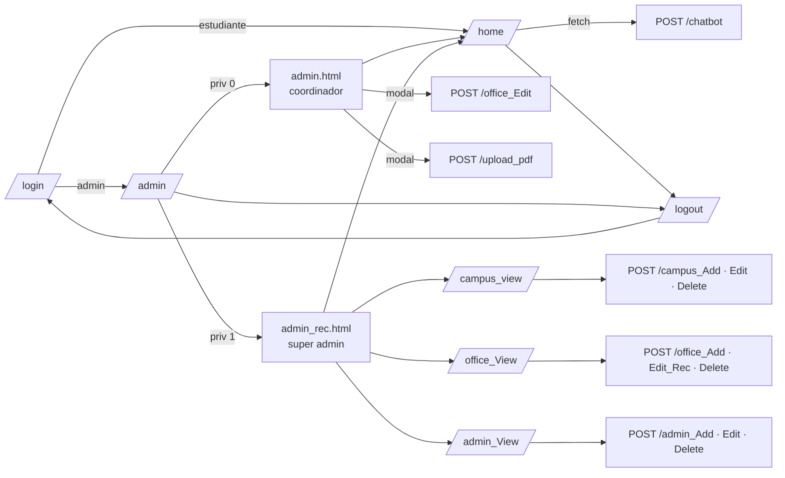

# 07 · Referencia de rutas HTTP

Todas las rutas están definidas en `src/app.py`. Las respuestas son HTML renderizado
salvo `/chatbot`, que responde JSON. Todos los `POST` requieren el campo
`csrf_token` (formularios) o la cabecera `X-CSRFToken` (fetch).

**Leyenda de acceso:** 🌐 público · 🔒 cualquier sesión (`@login_required`) ·
👤 pensado para estudiante · 🧑‍💼 pensado para coordinador · 🛡️ pensado para super admin.

> ⚠️ En la versión 4.1 **no se verifica el rol** en el servidor: cualquier sesión puede
> llamar las rutas 🛡️ y 🧑‍💼 si conoce la URL. Ver SEC-01 en
> [12-seguridad-riesgos-y-deuda-tecnica.md](12-seguridad-riesgos-y-deuda-tecnica.md).

## 1. Resumen

| Método | Ruta | Acceso | Respuesta | Descripción |
|---|---|---|---|---|
| GET | `/` | 🌐 | 302 → `/home` | Redirección a inicio |
| GET | `/login` | 🌐 | `auth/login.html` | Formulario de acceso |
| POST | `/login` | 🌐 | 302 / `auth/login.html` | Autenticación |
| GET | `/logout` | 🌐 | 302 → `/login` | Cierra sesión |
| GET | `/home` | 🔒 👤 | `home.html` / 404 | Mapa + chatbot |
| POST | `/chatbot` | 🔒 👤 | JSON | Pregunta al chatbot |
| GET, POST | `/admin` | 🔒 🧑‍💼 | `admin.html` o `admin_rec.html` | Panel según privilegio |
| POST | `/office_Edit` | 🔒 🧑‍💼 | 302 → `/admin` | Edita datos de contacto de la oficina |
| POST | `/upload_pdf` | 🔒 🧑‍💼 | 302 → `/admin` | Entrena el chatbot con un PDF |
| GET | `/campus_view` | 🔒 🛡️ | `campus_view.html` | Lista de campus |
| POST | `/campus_Add` | 🔒 🛡️ | 302 → `/admin` | Alta de campus |
| POST | `/campus_Edit` | 🔒 🛡️ | 302 → `/admin` | Edición de campus |
| POST | `/campus_Delete` | 🔒 🛡️ | 302 → `/admin` | Baja de campus |
| GET, POST | `/office_View` | 🔒 🛡️ | `office_view.html` | Lista de oficinas |
| POST | `/office_Add` | 🔒 🛡️ | 302 → `/office_View` | Alta de oficina |
| POST | `/office_Edit_Rec` | 🔒 🛡️ | 302 → `/office_View` | Edición de ubicación/carrera |
| POST | `/office_Delete` | 🔒 🛡️ | 302 → `/office_View` | Baja de oficina |
| GET, POST | `/admin_View` | 🔒 🛡️ | `admin_view.html` | Lista de administradores |
| POST | `/admin_Add` | 🔒 🛡️ | 302 → `/admin_View` | Alta de administrador |
| POST | `/admin_Edit` | 🔒 🛡️ | 302 → `/admin_View` | Edición de administrador |
| POST | `/admin_Delete` | 🔒 🛡️ | 302 → `/admin_View` | Baja de administrador |
| GET | `/protected` | 🔒 | HTML | Vista de prueba |

## 2. Detalle

### `POST /login`

| Campo (form) | Tipo | Requerido | Descripción |
|---|---|---|---|
| `codigo` | número | Sí | Código de estudiante o administrador |
| `password` | texto | Sí | Contraseña |
| `csrf_token` | texto | Sí | Token CSRF |

| Resultado | Respuesta |
|---|---|
| Estudiante activo | `302 /home` |
| Administrador | `302 /admin` |
| Contraseña incorrecta / inactivo | `200` login + "Contraseña incorrecta o Estudiante no activo" |
| No existe | `200` login + "Usurario no encontrado" |

### `GET /home`

Consulta el campus de `current_user.campus` y sus oficinas. Inyecta en la plantilla:

| Variable JS | Contenido |
|---|---|
| `offices` | Arreglo de filas `campus ⨝ offices` |
| `campusLat`, `campusLon` | Centro del mapa |
| `campusGeoJSON` | Polígono del campus |
| `csrfToken` | Token para `/chatbot` |

Devuelve `404 "Campus not found"` si el campus no tiene oficinas.

### `POST /chatbot`

**Petición**

```http
POST /chatbot HTTP/1.1
Content-Type: application/json
X-CSRFToken: <token>

{ "message": "¿Dónde entrego el reporte de servicio social?" }
```

**Respuesta 200**

```json
{
  "reply": "Debes entregar tu reporte en la Unidad de Servicio Social ... Puedes contactarla al ...",
  "office_id": "6"
}
```

| Caso | Respuesta |
|---|---|
| Sin embeddings cargados | `{"reply": "El chatbot aún no está listo. Por favor, procesa primero el PDF."}` |
| Error en OpenAI (chat) | `{"reply": "Lo siento, ha ocurrido un error al obtener la respuesta.", "office_id": "…"}` |
| Error en OpenAI (embedding de la pregunta) | `500` (excepción no capturada) |
| Sin sesión | `302 /login` |

### `POST /upload_pdf`

`multipart/form-data` con `pdf_file` (PDF) y `csrf_token`. El `office_id` se toma de
la oficina del administrador en sesión (`current_user.career`). Genera
`embeddings/embeddings_<office_id>.pkl`, recarga el índice y redirige a `/admin`.

> `GET /upload_pdf` intenta renderizar `upload_pdf.html`, plantilla que no existe en el
> repositorio (la carga se hace desde un modal en `admin.html`). Ver DT-07.

### `POST /office_Edit`

| Campo | Descripción |
|---|---|
| `office_id` | Oficina del coordinador (oculto) |
| `office_name`, `office_desc`, `office_phone`, `office_hours` | Nuevos valores (todos se sobrescriben) |

### `POST /campus_Add` · `POST /campus_Edit`

`multipart/form-data`:

| Campo | Add | Edit | Descripción |
|---|---|---|---|
| `campus_name` | ✔ | ✔ (oculto) | Clave del campus |
| `campus_lat`, `campus_lon` | ✔ | ✔ | Centro del mapa |
| `campus_coords` | ✔ archivo | ✔ archivo | GeoJSON del perímetro (`.json`) |

### `POST /campus_Delete`

`campus_name`.

### `POST /office_Add` · `POST /office_Edit_Rec` · `POST /office_Delete`

| Campo | Add | Edit_Rec | Delete |
|---|---|---|---|
| `office_id` | | ✔ | ✔ |
| `office_campus` | ✔ | | |
| `office_name` | ✔ | ✔ | |
| `office_lat`, `office_lon` | ✔ | ✔ | |
| `office_career` | ✔ | ✔ | |

### `POST /admin_Add` · `POST /admin_Edit` · `POST /admin_Delete`

| Campo | Add | Edit | Delete |
|---|---|---|---|
| `admin_cod` | ✔ | ✔ (clave) | ✔ |
| `admin_password` | ✔ (se guarda con hash) | | |
| `admin_fullname`, `admin_email` | ✔ | ✔ | |
| `admin_campus` | ✔ | ✔ | |
| `admin_office` | ✔ | ✔ | |
| `admin_priv` | ✔ (`1`/`0`) | ✔ | |

## 3. Manejo de errores

| Código | Manejador | Resultado |
|---|---|---|
| 401 | `status_401` | Redirección a `/login` |
| 404 | `status_404` | `<h1>Pagina no encontrada</h1>` |
| 400 (CSRF inválido) | Flask-WTF | Página de error por defecto |

Los manejadores y `CSRFProtect` se registran dentro de `if __name__ == '__main__'`, por
lo que **solo están activos al ejecutar `python src/app.py`**.

## 4. Mapa de navegación


