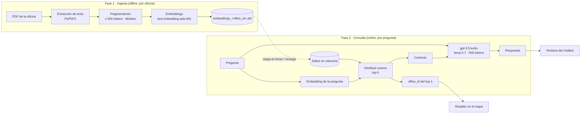

# 08 · Chatbot RAG

El chatbot de Lion Solver usa **Retrieval-Augmented Generation (RAG)**: en lugar de
reentrenar un modelo, recupera los fragmentos más relevantes de los documentos oficiales
de cada oficina y se los pasa como contexto a un modelo de lenguaje.

## 1. Visión general



## 2. Parámetros

| Parámetro | Valor | Ubicación |
|---|---|---|
| Modelo de embeddings | `text-embedding-ada-002` (1 536 dimensiones) | `src/app.py:96`, `:127` |
| Modelo de chat | `gpt-3.5-turbo` | `src/app.py:166` |
| Tokenizador | `cl100k_base` | `src/app.py:51` |
| Tamaño máximo de fragmento | 500 tokens | `split_text(max_tokens=500)` |
| Fragmentos recuperados (`top_k`) | 5 | `src/app.py:575` |
| `temperature` | 0.7 | `src/app.py:171` |
| `max_tokens` de la respuesta | 500 | `src/app.py:170` |
| SDK | `openai==0.28.0` (API heredada) | `requirements.txt` |
| Variable de entorno | `OPENAI_API_KEY` | `.env` |

## 3. Fase de ingesta

1. **Recepción** — `POST /upload_pdf` guarda el archivo en `uploads/<nombre>`.
2. **Extracción** — `extract_text_from_pdf()` recorre las páginas con `PyPDF2.PdfReader(strict=False)` y concatena el texto. Los PDF escaneados (solo imagen) producen texto vacío y se rechazan.
3. **Fragmentación** — `split_text()`:
   - divide el texto por `". "` (oraciones);
   - acumula oraciones mientras la suma de tokens sea ≤ 500;
   - si una sola oración excede 500 tokens, la parte por palabras en sub‑fragmentos.
4. **Vectorización** — `generate_embeddings()` llama a la API una vez por fragmento. Si un fragmento falla, se registra y se omite.
5. **Persistencia** — `save_embeddings()` serializa con `pickle` una lista de registros:

   ```python
   {"embedding": [0.0123, -0.0456, ...],  # 1536 floats
    "text": "Fragmento del documento...",
    "office_id": "6"}                       # str(current_user.career)
   ```

6. **Recarga** — se vacía `all_embeddings` y se vuelven a cargar todos los `.pkl` de `embeddings/`.

Un archivo por oficina ⇒ subir un PDF nuevo **reemplaza** el conocimiento anterior de
esa oficina. Para combinar varios documentos, únalos en un solo PDF antes de subirlo.

## 4. Fase de consulta

1. El cliente envía `{"message": "..."}` a `POST /chatbot`.
2. Si `all_embeddings` está vacío, responde que el chatbot no está listo.
3. `get_relevant_chunks()` obtiene el embedding de la pregunta y calcula
   `cosine_similarity` contra cada registro (búsqueda lineal), ordena de mayor a menor y
   devuelve los 5 primeros.
4. Se concatena el texto de los 5 fragmentos como **contexto**.
5. `office_id` = oficina del fragmento **más similar** (top‑1).
6. `get_office_info()` consulta la oficina en MySQL.
7. `get_answer()`:
   - si la pregunta es exactamente un saludo (`hola`, `buenos días`, `hi`, …) devuelve
     *"Hola, ¿en qué puedo ayudarte?"*;
   - en otro caso envía el *prompt* a `gpt-3.5-turbo`.
8. Responde `{"reply": ..., "office_id": ...}`; el cliente llama a `highlightOffice()`.

### 4.1 Prompt actual

```text
Utiliza el siguiente contexto para responder la pregunta de manera clara y concisa.
Al final de tu respuesta, indica cuál es la oficina correspondiente y cómo el estudiante puede contactarla.

Contexto:
{context}

Pregunta:
{question}

Respuesta:
```

> Observación: `office_info` (nombre, horario y teléfono reales de la oficina) se
> recibe en `get_answer()` pero **no se incluye en el prompt**, por lo que el modelo solo
> puede indicar datos de contacto si aparecen en el PDF. Ver HU-16.

## 5. Costos y desempeño

| Operación | Llamadas a la API | Comentario |
|---|---|---|
| Subir un PDF de *N* fragmentos | *N* embeddings | Un PDF de 20 páginas ≈ 20–40 fragmentos |
| Una pregunta | 1 embedding + 1 chat completion | El saludo exacto ahorra la llamada de chat pero **no** la de embedding |

La búsqueda es O(n) en Python puro por cada fragmento. Para cientos de fragmentos es
despreciable frente a la latencia de la API; para miles conviene vectorizar con NumPy
(`matrix @ q / norms`) o usar un índice ANN (FAISS, pgvector).

## 6. Evaluación recomendada

Para medir la calidad de forma objetiva antes de cambiar parámetros:

1. Crear un conjunto de 30–50 preguntas reales con la oficina esperada.
2. Medir **Precisión@1 de oficina** (¿`office_id` correcto?) y **Recall@5 de fragmento**.
3. Revisar manualmente una muestra de respuestas: exactitud, si inventa datos
   (alucinación), si menciona contacto.
4. Repetir tras cada cambio de `top_k`, tamaño de fragmento, modelo o prompt.

| Métrica | Meta propuesta |
|---|---|
| Precisión@1 de oficina | ≥ 0.80 |
| Respuestas sin datos inventados | ≥ 0.95 |
| Latencia p95 | < 8 s |

## 7. Mejoras propuestas

| Prioridad | Mejora | Beneficio |
|---|---|---|
| Alta | Migrar a `openai>=1.x` y a `text-embedding-3-small` + un modelo de chat vigente | Continuidad del servicio, menor costo |
| Alta | Inyectar `office_info` en el prompt | Respuestas con contacto y horario correctos |
| Alta | Instrucción "si el contexto no contiene la respuesta, dilo" y `temperature` ≤ 0.3 | Menos alucinaciones |
| Media | Umbral mínimo de similitud para devolver `office_id` | Evita resaltar oficinas irrelevantes |
| Media | Fragmentos con solapamiento (p. ej. 50 tokens) | Mejor recuperación en bordes de fragmento |
| Media | Almacén vectorial compartido (pgvector/Chroma) | Varios workers, sin `pickle` |
| Baja | Historial de conversación por sesión | Preguntas de seguimiento |
| Baja | *Streaming* de la respuesta | Percepción de velocidad |
