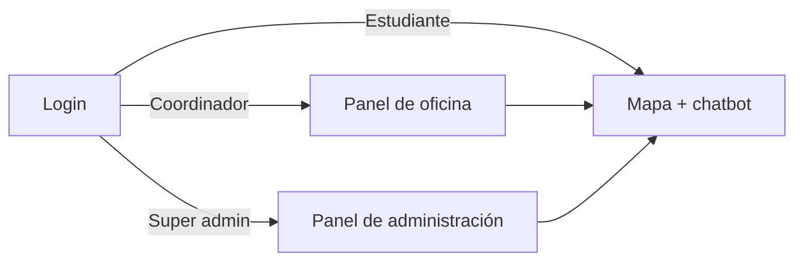
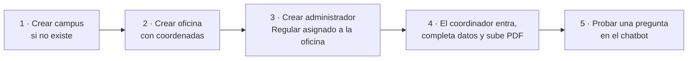

# 10 · Manual de usuario

## 1. Acceso al sistema

1. Abra la dirección de Lion Solver en su navegador (computadora o celular).
2. Escriba su **código** (número de estudiante o de administrador) y su **contraseña**.
3. Pulse **Iniciar sesión**.

| Mensaje | Significado | Qué hacer |
|---|---|---|
| "Usurario no encontrado" | El código no está registrado | Verifique el código o solicite el alta al administrador |
| "Contraseña incorrecta o Estudiante no activo" | Contraseña errónea o cuenta desactivada | Reintente o contacte al administrador |
| "Contraseña incorrecta" | (administradores) contraseña errónea | Reintente |

Para salir, pulse **Cerrar sesión** en la esquina superior derecha.

---

## 2. Estudiantes

### 2.1 Mapa del campus

Al entrar verá el nombre de su campus y un mapa con:

- **Contorno del campus** — línea negra con relleno azul claro.
- **Marcadores de oficinas** — pulse uno para ver su nombre y descripción.
- **Zoom** — use los botones `+`/`−`, la rueda del ratón o el gesto de pellizco.

### 2.2 Preguntar al chatbot

1. Pulse el **icono del león** en la esquina inferior.
2. Escriba su pregunta, por ejemplo:
   - *"¿Qué necesito para liberar mi servicio social?"*
   - *"¿Dónde entrego mi reporte bimestral?"*
3. Pulse **Enviar** o la tecla **Enter**.
4. Lea la respuesta. Si el sistema identifica una oficina, el mapa **se acerca a ella**,
   cambia su marcador por uno **resaltado** y abre su información.
5. Cierre la ventana con **×**; el mapa sigue visible.

**Consejos para mejores respuestas**

- Haga preguntas concretas y completas (una duda por mensaje).
- Mencione el trámite por su nombre (servicio social, titulación, constancia…).
- El chatbot no recuerda mensajes anteriores: incluya el contexto en cada pregunta.
- Si la respuesta no es útil, reformule la pregunta o acuda a la oficina resaltada.

---

## 3. Coordinadores de oficina

Al iniciar sesión verá tres tarjetas:

| Tarjeta | Acción |
|---|---|
| **Ver Mapa** | Abre el mapa del campus con el chatbot (igual que un estudiante). |
| **Editar oficina** | Abre un formulario para actualizar nombre, descripción, teléfono y horario. |
| **Entrenar Chatbot** | Permite subir el PDF con la información de su oficina. |

### 3.1 Editar la oficina

1. Pulse **Editar Oficina**.
2. Complete **todos** los campos: nombre, descripción, teléfono y horario.
3. Pulse **Guardar cambios**.

> ⚠️ El formulario se abre vacío y guarda todos los campos; si deja uno en blanco, se
> borrará el valor actual. Escriba de nuevo los datos que no quiera cambiar.

La **descripción** es el texto que verán los estudiantes al pulsar el marcador.

### 3.2 Entrenar el chatbot

1. Prepare **un solo PDF** con toda la información de su oficina: trámites, requisitos,
   fechas, ubicación, teléfono, correo y horario.
2. Pulse **Entrenar Chatbot**, seleccione el archivo y pulse **Subir PDF**.
3. Espere el mensaje *"El PDF ha sido procesado y los embeddings se han generado
   correctamente."* (puede tardar de segundos a un par de minutos según el tamaño).

**Buenas prácticas para el PDF**

| Hacer | Evitar |
|---|---|
| PDF generado desde Word/Docs (texto seleccionable) | PDF escaneado o fotos de documentos |
| Frases completas terminadas en punto | Tablas complejas o texto en columnas |
| Incluir el nombre de la oficina y sus datos de contacto | Información de otras oficinas |
| Un documento que reúna todo | Subir varios PDF por separado (cada carga **reemplaza** la anterior) |

---

## 4. Super administradores

El panel muestra cuatro tarjetas: **Ver Mapa**, **Ver Campus**, **Ver Oficinas** y
**Ver Administradores**. Cada listado tiene un botón para **agregar** y, por fila,
botones para **editar** y **eliminar**.

### 4.1 Campus

| Campo | Descripción |
|---|---|
| Nombre | Identificador único (no se puede cambiar después). |
| Latitud / Longitud | Punto donde se centrará el mapa. Se obtiene, por ejemplo, con clic derecho en Google Maps u OpenStreetMap. |
| Archivo de coordenadas | Archivo `.json` en formato GeoJSON con el contorno del campus. Puede dibujarse en <https://geojson.io> y exportarse. Ejemplo: `src/static/json/cucei.json`. |

> Eliminar un campus elimina sus oficinas; no podrá eliminarse si tiene estudiantes o
> administradores asignados.

### 4.2 Oficinas

| Campo | Descripción |
|---|---|
| Campus | Campus al que pertenece. |
| Nombre | Nombre visible en el mapa. |
| Latitud / Longitud | Ubicación exacta del marcador (debe estar dentro del contorno del campus). |
| Carrera | Carrera o área que atiende. |

La descripción, el teléfono y el horario los captura el **coordinador** de la oficina.
La columna **Coordinador** muestra quién la administra.

### 4.3 Administradores

| Campo | Descripción |
|---|---|
| Código | Usuario de inicio de sesión. No debe coincidir con un código de estudiante. |
| Contraseña | Solo al crear; se guarda cifrada. |
| Nombre y correo | Datos de contacto. |
| Campus | Define el mapa que verá. |
| Oficina | Oficina que coordina y a la que se asocian sus PDFs. |
| Privilegio | **Super** (administración completa) o **Regular** (coordinador). |

Flujo recomendado para dar de alta una oficina nueva:

---

## 5. Preguntas frecuentes

**¿Por qué el chatbot dice "aún no está listo"?**
Ninguna oficina ha subido todavía su PDF.

**¿Por qué el mapa no resalta ninguna oficina?**
La oficina de la respuesta no pertenece al campus que está viendo, o fue eliminada.

**¿Puedo usarlo desde el celular?**
Sí, la interfaz se adapta a pantallas pequeñas.

**¿Quién da de alta a los estudiantes?**
Actualmente se registran directamente en la base de datos por el área de sistemas.
