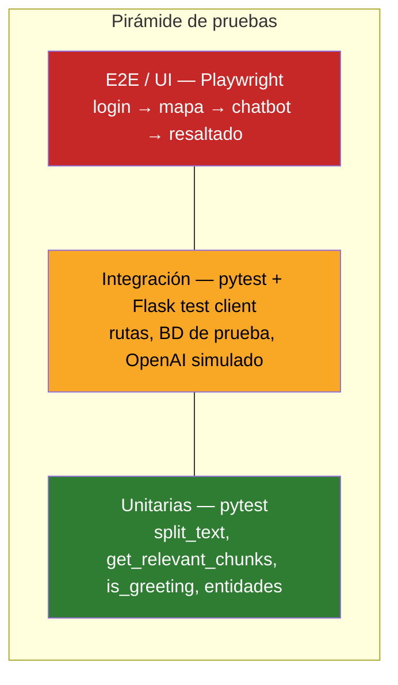

# 11 · Plan de pruebas

Basado en la estructura de ISO/IEC/IEEE 29119‑3.

## 1. Alcance

| En alcance | Fuera de alcance |
|---|---|
| Autenticación y sesión | Calidad lingüística de los modelos de OpenAI |
| Mapa y resaltado de oficinas | Disponibilidad de OpenStreetMap / CDN |
| Chatbot (flujo completo y casos de error) | Pruebas de carga a gran escala |
| Ingesta de PDF | Compatibilidad con navegadores obsoletos (IE) |
| CRUD de campus, oficinas y administradores | |
| Controles de seguridad básicos | |

## 2. Estrategia



| Nivel | Herramienta | Qué cubre | Dobles de prueba |
|---|---|---|---|
| Unitario | `pytest` | Funciones puras del motor RAG y entidades | `tiktoken` real; OpenAI simulado con `unittest.mock` |
| Integración | `pytest` + `app.test_client()` | Rutas, sesiones, CSRF, SQL | MySQL de prueba (contenedor) u objetos simulados; OpenAI simulado |
| Sistema / E2E | Playwright | Recorridos de usuario en navegador | Backend real con datos semilla |
| Aceptación | Manual guiada por Gherkin | Historias de usuario ([03-scrum.md](03-scrum.md#63-criterios-de-aceptación-selección-formato-gherkin)) | — |
| Seguridad | Manual + `bandit`, `pip-audit` | Autorización, CSRF, archivos, dependencias | — |

## 3. Entorno

| Elemento | Valor |
|---|---|
| Base de datos | `lion_solver_test` creada con `docs/database/schema.sql` + datos semilla |
| Variables | `OPENAI_API_KEY=test` (las llamadas se simulan) |
| Navegadores | Chromium (escritorio y emulación móvil 390×844) |
| Datos | 1 campus (CUCEI), 3 oficinas, 1 super admin, 1 coordinador, 2 estudiantes (activo/inactivo) |

## 4. Casos de prueba

### 4.1 Autenticación (RF-01 a RF-06)

| ID | Caso | Pasos / datos | Resultado esperado | Prioridad |
|---|---|---|---|---|
| CP-01 | Login estudiante activo | Código y contraseña válidos | 302 → `/home`; mapa visible | Alta |
| CP-02 | Login estudiante inactivo | `user_active = 0` | Permanece en login; mensaje de no activo | Alta |
| CP-03 | Login con contraseña incorrecta | Código válido, contraseña errónea | Mensaje de error; sin sesión | Alta |
| CP-04 | Login con código inexistente | Código `999999` | "Usurario no encontrado" | Media |
| CP-05 | Login de administrador | Admin super y regular | 302 → `/admin`; panel correspondiente al privilegio | Alta |
| CP-06 | Acceso sin sesión | GET `/home`, `/admin`, POST `/chatbot` | Redirección a `/login` | Alta |

### 4.2 Mapa (RF-07 a RF-10)

| ID | Caso | Resultado esperado | Prioridad |
|---|---|---|---|
| CP-07 | Carga del mapa | Centro en `campus_lat/lon`, zoom 17, polígono dibujado | Alta |
| CP-08 | Marcadores | Un marcador por oficina del campus; popup con nombre y descripción | Alta |
| CP-09 | Campus sin oficinas | `/home` responde 404 "Campus not found" | Media |
| CP-10 | `highlightOffice(id)` | Icono resaltado, zoom 18, popup abierto; los demás vuelven al icono normal | Alta |

### 4.3 Chatbot (RF-11 a RF-16)

| ID | Caso | Datos | Resultado esperado | Prioridad |
|---|---|---|---|---|
| CP-11 | Pregunta válida | "¿Dónde entrego mi servicio social?" | JSON con `reply` no vacío y `office_id` | Alta |
| CP-12 | Índice vacío | Sin `.pkl` | Mensaje "El chatbot aún no está listo…" | Alta |
| CP-13 | Saludo | "hola" | "Hola, ¿en qué puedo ayudarte?" sin llamada a chat completion | Baja |
| CP-14 | Falla del modelo de chat | OpenAI simulado lanza excepción | Mensaje de disculpa, HTTP 200 | Media |
| CP-15 | Sin token CSRF | POST sin `X-CSRFToken` | 400 | Alta |
| CP-16 | Mensaje vacío | Input con espacios | No se envía la petición | Baja |
| CP-17 | Selección de oficina | Fragmentos simulados con similitudes conocidas | `office_id` = oficina del fragmento con mayor similitud | Alta |

### 4.4 Gestión de oficina e ingesta (RF-17 a RF-20)

| ID | Caso | Resultado esperado | Prioridad |
|---|---|---|---|
| CP-18 | Editar datos de oficina | Valores actualizados en `offices`; mensaje de éxito | Alta |
| CP-19 | Subir PDF con texto | Se crea `embeddings/embeddings_<office_id>.pkl` con *N* registros; índice recargado | Alta |
| CP-20 | Subir PDF escaneado | Mensaje "El PDF no contiene texto…"; no se crea `.pkl` | Media |
| CP-21 | Reemplazo de conocimiento | Segundo PDF sustituye al primero para la misma oficina | Media |
| CP-22 | `split_text` | Ningún fragmento supera 500 tokens; no se pierde texto | Alta |

### 4.5 Administración (RF-21 a RF-23)

| ID | Caso | Resultado esperado | Prioridad |
|---|---|---|---|
| CP-23 | Alta de campus con GeoJSON válido | Registro creado; aparece en `/campus_view` | Alta |
| CP-24 | Alta de campus con JSON inválido | Mensaje "El archivo JSON no es válido." | Media |
| CP-25 | Edición de campus | Coordenadas y polígono actualizados | Media |
| CP-26 | Baja de campus | Registro eliminado (o error controlado si tiene dependencias) | Media |
| CP-27 | Alta de oficina | Aparece en listado y en el mapa del campus | Alta |
| CP-28 | Edición de ubicación | Marcador en la nueva posición | Media |
| CP-29 | Baja de oficina | Desaparece de listado y mapa | Media |
| CP-30 | Alta de administrador | Contraseña almacenada con hash (no en claro) | Alta |
| CP-31 | Edición de privilegio | Cambia el panel que ve al iniciar sesión | Media |
| CP-32 | Baja de administrador | No puede iniciar sesión | Media |

### 4.6 Seguridad

| ID | Caso | Resultado esperado | Estado v4.1 |
|---|---|---|---|
| CP-33 | Estudiante llama `POST /admin_Add` | 403 | ❌ Falla (SEC-01) |
| CP-34 | Coordinador llama `POST /campus_Delete` | 403 | ❌ Falla (SEC-01) |
| CP-35 | Inyección SQL en `codigo` | Sin efecto (consulta parametrizada) | ✅ |
| CP-36 | Subir archivo `../../app.py` como PDF | Nombre saneado; sin escritura fuera de `uploads/` | ⚠️ Revisar (SEC-03) |
| CP-37 | XSS en `office_desc` (``) | Se muestra como texto | ❌ Falla (SEC-04) |

## 5. Ejemplos de pruebas automatizadas

Estructura propuesta:

```text
tests/
├── conftest.py          # app de prueba, cliente, mocks de OpenAI
├── test_rag.py          # split_text, get_relevant_chunks, get_answer
├── test_auth.py         # login/logout
└── test_routes.py       # CRUD y autorización
```

`tests/test_rag.py`:

```python
import tiktoken
from unittest.mock import patch

import app as lion


def test_split_text_divide_y_conserva_el_texto():
    enc = tiktoken.get_encoding("cl100k_base")
    oraciones = ["Esta es una oración de prueba número %d" % i for i in range(500)]
    chunks = lion.split_text(". ".join(oraciones), max_tokens=100)
    assert len(chunks) > 1
    assert all(chunks)
    # El límite se mide por oración sin contar el ". " que se agrega al unirlas,
    # por eso se tolera un pequeño excedente (una ficha por oración).
    assert all(len(enc.encode(c)) <= 100 + len(c.split(". ")) for c in chunks)
    unido = " ".join(chunks)
    assert all(o in unido for o in oraciones)


def test_get_relevant_chunks_ordena_por_similitud():
    embeddings = [
        {"embedding": [1.0, 0.0], "text": "A", "office_id": "1"},
        {"embedding": [0.0, 1.0], "text": "B", "office_id": "2"},
    ]
    fake = {"data": [{"embedding": [0.1, 0.9]}]}
    with patch.object(lion.openai.Embedding, "create", return_value=fake):
        top = lion.get_relevant_chunks("pregunta", embeddings, top_k=1)
    assert top[0][1]["office_id"] == "2"


def test_saludo_no_llama_al_modelo():
    with patch.object(lion.openai.ChatCompletion, "create") as chat:
        assert lion.get_answer("hola", "", {}) == "Hola, ¿en qué puedo ayudarte?"
        chat.assert_not_called()
```

Ejecución (desde la raíz, con `src/` en el *path*):

```bash
pip install pytest
PYTHONPATH=src pytest -q
```

> Importar `app` ejecuta la carga de embeddings y requiere `src/config.py`. Para pruebas
> aisladas se recomienda extraer el motor RAG a un módulo propio (`src/rag.py`), ver DT-04.

## 6. Criterios de entrada y salida

| Criterio | Entrada | Salida |
|---|---|---|
| Código | Rama con la historia terminada | Todas las pruebas de prioridad Alta pasan |
| Defectos | — | 0 defectos críticos o altos abiertos |
| Cobertura | — | ≥ 70 % en `models/` y motor RAG |
| Seguridad | — | CP-33 a CP-37 en verde antes de producción |

## 7. Clasificación de defectos

| Severidad | Definición | Ejemplo |
|---|---|---|
| Crítica | Pérdida de datos o brecha de seguridad | Estudiante puede borrar administradores |
| Alta | Funcionalidad principal no disponible | El chatbot siempre responde error |
| Media | Funcionalidad degradada con alternativa | Formulario de edición borra campos vacíos |
| Baja | Cosmético | Errata "Usurario" |
