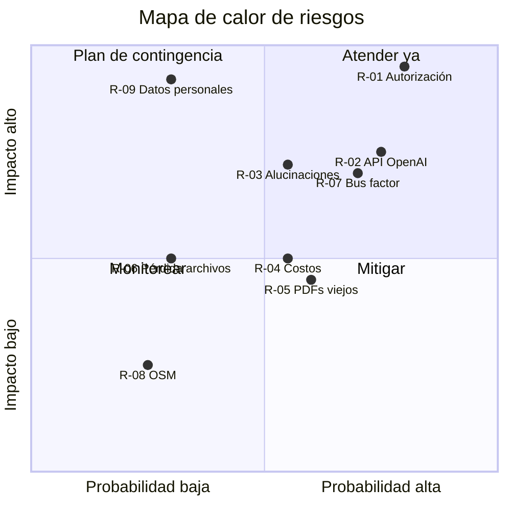
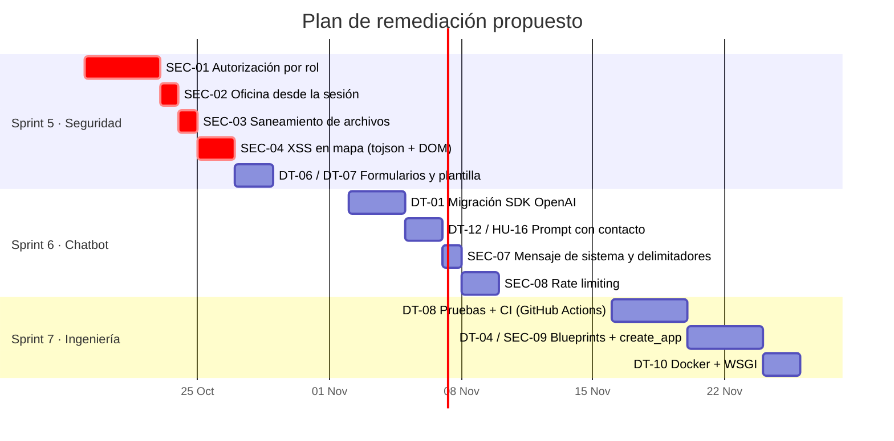

# 12 · Seguridad, riesgos y deuda técnica

Revisión estática del código de la versión 4.1. Severidad según CVSS cualitativo
(Crítica · Alta · Media · Baja).

## 1. Controles existentes

| Control | Implementación | Referencia |
|---|---|---|
| Hash de contraseñas | `generate_password_hash` / `check_password_hash` (Werkzeug) | `src/app.py:505`, `src/models/entities/*.py` |
| Protección CSRF | `CSRFProtect` + `csrf_token` en formularios + `X-CSRFToken` en fetch | `src/app.py:662`, `chatbot.js:47` |
| Consultas parametrizadas | `cursor.execute(sql, params)` en todo el código | `src/app.py`, `src/models/` |
| Autenticación de vistas | `@login_required` en todas las rutas privadas | `src/app.py` |
| Secretos fuera del repositorio | `.env` y `config.py` en `.gitignore` | `.gitignore` |
| Escapado de plantillas | Autoescape de Jinja2 en vistas HTML | `src/template/` |

## 2. Hallazgos de seguridad

| ID | Severidad | Hallazgo | Evidencia | Recomendación |
|---|---|---|---|---|
| SEC-01 | **Crítica** | **Falta de autorización por rol.** Todas las rutas de administración solo exigen sesión; un estudiante autenticado puede crear/editar/borrar campus, oficinas y administradores (incluido crearse una cuenta de super admin) y subir PDFs. | `src/app.py:291-561`, `:601` | Decorador `@role_required('super')` / `@role_required('admin')` que compruebe `isinstance(current_user, Admin)` y `current_user.priv`; responder 403. |
| SEC-02 | Alta | **Edición de oficina ajena.** `/office_Edit` confía en el `office_id` oculto del formulario; un coordinador puede editar cualquier oficina cambiando ese valor. | `src/app.py:431` | Usar `current_user.career` en el servidor en lugar del campo del formulario. |
| SEC-03 | Alta | **Nombre de archivo sin sanear.** `os.path.join('uploads', pdf_file.filename)` permite rutas como `../src/app.py` (*path traversal*) y no valida tipo ni tamaño. | `src/app.py:609` | `werkzeug.utils.secure_filename`, validar extensión y *magic bytes* `%PDF`, `MAX_CONTENT_LENGTH`. |
| SEC-04 | Alta | **XSS almacenado en el mapa.** `bindPopup("<b>" + office_name + "</b><br>" + office_desc)` inserta HTML sin escapar; además `{{ offices_json \| safe }}` dentro de `<script>` permite cerrar la etiqueta con `</script>`. Un coordinador podría ejecutar JavaScript en el navegador de todos los estudiantes. | `src/static/js/mapa.js:31`, `src/template/home.html:76` | Construir el popup con nodos DOM / `textContent`; usar el filtro `tojson` de Jinja2 (escapa `<`, `>`, `&`). |
| SEC-05 | Media | **Colisión de identificadores.** `load_user` busca primero en `users` y luego en `admins`; si un código existe en ambas tablas, la sesión de un administrador se recarga como estudiante (o viceversa). | `src/app.py:203-212` | Prefijar el id de sesión (`u:123` / `a:123`) o unificar cuentas en una tabla con rol. |
| SEC-06 | Media | **Deserialización con `pickle`.** Todos los `.pkl` de `embeddings/` se cargan al iniciar; un archivo manipulado permitiría ejecución de código. | `src/app.py:112-120` | Guardar embeddings en JSON/NumPy (`.npy`) o en un almacén vectorial; restringir permisos de la carpeta. |
| SEC-07 | Media | **Inyección de prompt.** El texto de los PDF y la pregunta se insertan sin delimitar en el prompt. | `src/app.py:153-162` | Delimitar contexto (p. ej. etiquetas), mensaje de sistema con instrucciones, filtrar salida. |
| SEC-08 | Media | **Sin límite de frecuencia.** `/login` y `/chatbot` no limitan intentos: fuerza bruta de contraseñas y consumo de la API de OpenAI. | `src/app.py:222`, `:564` | `Flask-Limiter` (p. ej. 5/min en login, 20/min en chatbot por usuario). |
| SEC-09 | Media | **Configuración solo en `__main__`.** Con otro servidor (`flask run`, Gunicorn) no se activan CSRF ni la configuración. | `src/app.py:659-665` | Patrón *application factory* (`create_app()`). |
| SEC-10 | Baja | **Logout por GET.** Permite cerrar la sesión de otro usuario mediante un enlace o imagen (CSRF de logout). | `src/app.py:254` | `POST /logout` con token CSRF. |
| SEC-11 | Baja | **Registro de datos sensibles.** Se imprimen en consola las preguntas y respuestas completas. | `src/app.py:567-597` | Usar `logging` con niveles; no registrar contenido de usuarios en producción. |
| SEC-12 | Baja | **Dependencias sin auditar.** Versiones fijadas de 2024 (`openai 0.28`, `PyPDF2 3.0.1` —obsoleto, sucesor `pypdf`). | `requirements.txt` | `pip-audit` en CI; Dependabot. |

### 2.1 Ejemplo de corrección para SEC-01

```python
from functools import wraps
from flask import abort

def role_required(super_only=False):
    def decorator(view):
        @wraps(view)
        def wrapper(*args, **kwargs):
            if not isinstance(current_user, Admin):
                abort(403)
            if super_only and int(current_user.priv) != 1:
                abort(403)
            return view(*args, **kwargs)
        return wrapper
    return decorator


@app.route('/admin_Add', methods=["POST"])
@login_required
@role_required(super_only=True)
def admin_Add():
    ...
```

## 3. Matriz de riesgos del proyecto

Probabilidad (P) e impacto (I) de 1 a 5; exposición = P × I.

| ID | Riesgo | P | I | Exposición | Respuesta | Responsable |
|---|---|---|---|---|---|---|
| R-01 | Uso indebido de rutas de administración por usuarios no autorizados (SEC-01) | 4 | 5 | **20** | Mitigar: HU-14 en el próximo sprint | Developers |
| R-02 | Retiro de la API `openai<1.0`, `ada-002` o `gpt-3.5-turbo` | 4 | 4 | **16** | Mitigar: HU-17 | Developers |
| R-03 | Respuestas incorrectas o inventadas del chatbot | 3 | 4 | 12 | Mitigar: prompt restrictivo, evaluación, aviso al usuario | PO + Developers |
| R-04 | Costos imprevistos de OpenAI | 3 | 3 | 9 | Mitigar: límites de gasto y de frecuencia | PO |
| R-05 | PDFs desactualizados en las oficinas | 3 | 3 | 9 | Aceptar/mitigar: recordatorio semestral a coordinadores | PO |
| R-06 | Pérdida de `embeddings/` o `uploads/` | 2 | 3 | 6 | Mitigar: respaldo junto con la BD | Operación |
| R-07 | Dependencia de un solo desarrollador (*bus factor* = 1) | 4 | 4 | **16** | Mitigar: esta documentación, revisión de código, pares | Scrum Master |
| R-08 | Caída de teselas de OpenStreetMap | 2 | 2 | 4 | Aceptar; alternativa: proveedor de teselas propio | Operación |
| R-09 | Datos personales de estudiantes (nombre, correo) expuestos | 2 | 5 | 10 | Mitigar: HTTPS, mínimos privilegios, aviso de privacidad | PO |



## 4. Deuda técnica

| ID | Tipo | Descripción | Ubicación | Esfuerzo | Prioridad |
|---|---|---|---|---|---|
| DT-01 | Dependencias | SDK `openai==0.28` (API heredada `openai.Embedding` / `openai.ChatCompletion`) y modelos antiguos. | `src/app.py:94,125,165` | M | Alta |
| DT-02 | Código muerto | `app2.py` es una copia antigua sin chatbot; `index.html` y `login.js` están vacíos; `render_template_string`, `numpy` sin uso. | `src/` | S | Media |
| DT-03 | Dependencias | `folium`, `branca`, `pandas`, `metrics`, `pairwise`, `cosine-similarity` instalados sin uso tras ADR-005. | `requirements.txt` | S | Baja |
| DT-04 | Diseño | `app.py` concentra rutas, SQL y RAG (665 líneas). | `src/app.py` | L | Media |
| DT-05 | Diseño | El atributo `password` de las entidades almacena texto, booleano o `None` según el momento. | `src/models/entities/` | S | Baja |
| DT-06 | UX / datos | Formularios de edición del coordinador no precargan valores; guardar en blanco borra datos. | `src/template/admin.html` | S | Alta |
| DT-07 | Error | `GET /upload_pdf` y la rama de "PDF sin texto" redirigen a `upload_pdf.html`, que no existe (500). | `src/app.py:616,644` | S | Alta |
| DT-08 | Calidad | Sin pruebas automatizadas ni CI. | — | M | Alta |
| DT-09 | Configuración | Rutas `embeddings/` y `uploads/` relativas al directorio de trabajo; `PORT` se lee pero no se usa en `app.run()`. | `src/app.py:186,607,660` | S | Media |
| DT-10 | Operación | Sin Dockerfile ni punto de entrada WSGI. | — | M | Media |
| DT-11 | Datos | Al borrar una oficina su `.pkl` no se elimina; el chatbot puede seguir sugiriéndola. | `src/app.py:463` | S | Media |
| DT-12 | Consistencia | El comentario dice "office_id más común" pero se usa el top‑1; `office_info` no se usa en el prompt. | `src/app.py:585,144` | S | Media |
| DT-13 | Codificación | `requirements.txt` en UTF‑16 (algunas herramientas no lo leen). | `requirements.txt` | S | Baja |
| DT-14 | Datos | `campus_coords` se envía al conector MySQL como `dict`; conviene serializarlo explícitamente con `json.dumps` antes del `INSERT`/`UPDATE`. | `src/app.py:315,345` | S | Media |
| DT-15 | Mensajes | `flash(mensaje, e)` pasa la excepción como *categoría*; erratas como "Usurario" o "Cuenta editada" en edición de oficina. | `src/app.py:248,321,441` | S | Baja |
| DT-16 | Consultas | Uso extendido de `SELECT *` con `JOIN`, que mezcla columnas y expone campos innecesarios (p. ej. hashes) a las plantillas. | `src/app.py:399,482,554` | S | Media |

Esfuerzo: S ≤ ½ día · M 1–3 días · L > 3 días.

## 5. Plan de remediación



Las fechas son una propuesta a partir del siguiente Sprint Planning y deben ajustarse
a la capacidad real del equipo.
