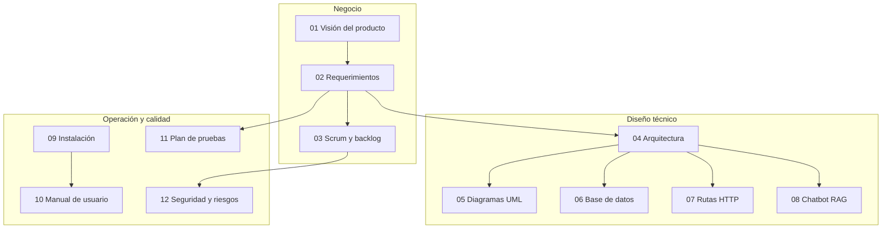

# Documentación de Lion Solver

| Campo | Valor |
|---|---|
| Producto | Lion Solver — geolocalización de oficinas + chatbot |
| Versión del software documentada | 4.1 (commit `c23db33`, 2024-12-12) |
| Versión del documento | 1.0 |
| Idioma | Español |
| Notación de diagramas | [Mermaid](https://mermaid.js.org/) (se renderiza directamente en GitHub) |

## Mapa de la documentación

## Índice

1. [Visión del producto](01-vision-del-producto.md)
2. [Especificación de requerimientos](02-requerimientos.md)
3. [Gestión ágil con Scrum](03-scrum.md)
4. [Arquitectura del sistema](04-arquitectura.md)
5. [Diagramas UML](05-diagramas-uml.md)
6. [Base de datos](06-base-de-datos.md) — script: [`database/schema.sql`](database/schema.sql)
7. [Referencia de rutas HTTP](07-referencia-rutas.md)
8. [Chatbot RAG](08-chatbot-rag.md)
9. [Instalación y despliegue](09-instalacion-y-despliegue.md)
10. [Manual de usuario](10-manual-de-usuario.md)
11. [Plan de pruebas](11-plan-de-pruebas.md)
12. [Seguridad, riesgos y deuda técnica](12-seguridad-riesgos-y-deuda-tecnica.md)

## Versiones para descargar

Toda la documentación unificada en un solo archivo (portada, índice, 36 diagramas y anexos):

- Word: [`export/LionSolver_Documentacion.docx`](export/LionSolver_Documentacion.docx)
- PDF: [`export/LionSolver_Documentacion.pdf`](export/LionSolver_Documentacion.pdf)

## Guía de lectura por perfil

| Perfil | Lectura recomendada |
|---|---|
| Product Owner / stakeholder | 01 → 02 → 03 → 10 |
| Desarrollador que se incorpora | 09 → 04 → 05 → 06 → 07 → 08 → 12 |
| QA / tester | 02 → 11 → 07 → 10 |
| Responsable de seguridad / operación | 12 → 09 → 04 |

## Convenciones

- **RF-xx / RNF-xx / RN-xx**: requerimiento funcional, no funcional y regla de negocio.
- **HU-xx**: historia de usuario del Product Backlog; **EP-xx**: épica.
- **CP-xx**: caso de prueba; **R-xx**: riesgo; **SEC-xx**: hallazgo de seguridad; **DT-xx**: deuda técnica.
- Las referencias a código usan la forma `archivo:línea`, por ejemplo `src/app.py:564`.

## Nota sobre las fuentes

Esta documentación se elaboró a partir del código fuente y del historial de Git. Dos
artefactos no están en el repositorio y se **reconstruyeron por inferencia**:

- **Esquema de base de datos**: deducido de las consultas SQL en `src/app.py` y
  `src/models/`. Ver [06-base-de-datos.md](06-base-de-datos.md).
- **Planificación Scrum**: los sprints se reconstruyeron a partir de las fechas de los
  commits (versiones 1.0 a 4.1); las estimaciones en puntos de historia son de referencia.
  Ver [03-scrum.md](03-scrum.md).
